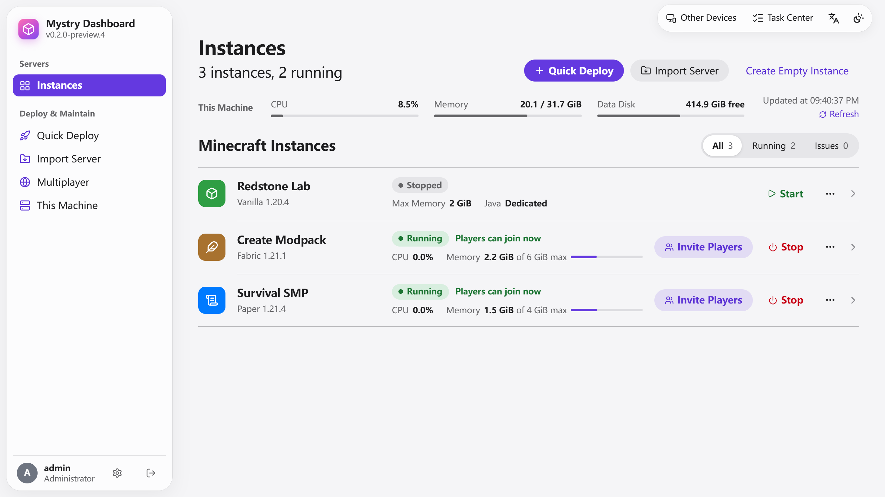

# Mystry Dashboard

**English** · [简体中文](README.zh-CN.md)


**A self-hosted game server panel, now supporting Minecraft: Java Edition.**



Run it on a home PC or a cloud server and manage it from any browser, phone included. One-click deploys, a live console, backups while players are online, and multiplayer without a public IP; no Docker or external database required.

Mystry Dashboard is a standalone Node.js application, not a game mod, and needs neither Fabric nor Forge.

[Quick Start](#quick-start) · [Features](#features) · [Documentation](docs/README.md) · [Tutorials](docs/tutorials.md) · [Contributing](CONTRIBUTING.md)

> **Preview software.** Read [Scope and limitations](#scope-and-limitations) before running a long-term server on it.

---

## Who It's For

For players hosting servers for themselves and their friends, at home or in the cloud:

- **Unzip and Run** — The portable builds for Windows x64 and Linux x64 include Node.js 22 and everything else the panel needs. Double-clicking `mdash.cmd` starts the panel in the background and shows the `admin` password once. Closing the window leaves the panel and your servers running.
- **Multiplayer Without a Public IP** — Turn on **Virtual LAN** and send friends the join instructions. There's no port forwarding or sign-up, and the panel adds the Windows Firewall rules for you. Public IPv6, your own relay nodes and your own **frp** server work too. Only the game port is shared, never the panel.
- **Startup Failures, With Fixes** — If the EULA hasn't been accepted, click **Agree and Start**. If the server needs a different Java, the panel names the version and can install it. Memory and JVM flags are set in a form with G1GC presets, plus Aikar's flags for Paper.
- **Live Backups** — A backup turns off world saving, flushes the world to disk, packs the folder and turns saving back on, so you never copy a half-written world. A restore checks every file first and backs up the current server before replacing it.
- **Slow or Blocked Networks** — Switch the download source to **China Mirrors** in **Panel Settings**. Mirrored files are used only when their checksum can be verified. frp and EasyTier can also be installed from an archive you upload.
- **Any Device, Three Languages** — Light and dark appearance, bottom navigation on phones and tablets, and a screen-reader mode for the console. The panel loads no web fonts, so it opens offline, and it's available in English, Simplified Chinese and Traditional Chinese.

### How It Compares

| | Startup scripts (`.bat` / `.sh`) | Data-center panels (e.g. Pterodactyl) | Mystry Dashboard |
|---|---|---|---|
| **Setup** | Edit flags, `eula.txt` and ports by hand | Linux, Docker, MySQL, Redis and the Wings daemon | One portable folder, Node.js 22 included |
| **Friends without a public IP** | Set up a tunnel and firewall rules yourself | Not built in | Virtual LAN (EasyTier) and frp built in |
| **Backing up a running world** | Copy the folder while the server writes to it | Built in | Saving is paused and the world flushed before every backup |
| **Slow or blocked downloads** | Download files by hand | No built-in mirror switch | China mirrors with checksum checks, or upload the file yourself |

---

## Features

| Area | What you can do |
|---|---|
| **Instances** | Create, start, stop, restart, force stop and delete as many servers as you need. Destructive actions ask you to confirm, and the panel tells you when players can join. |
| **Console** | Live server output colored by log level, a command box, a screen-reader mode, and automatic reconnects. |
| **Files & Properties** | Browse, upload and download files of any size, edit text files, rename, and edit `server.properties` in a grouped form that keeps your comments. |
| **Quick Deploy** | Deploy **Paper**, **Fabric**, **Forge**, **NeoForge** or **Vanilla**, from legacy versions up to Minecraft 26.x. Paper and the latest stable release are preselected. |
| **Import Server** | See what's inside a ZIP before importing it, or copy in an existing server folder. Your original folder is never changed. |
| **Backups** | Back up a whole server folder, even while it's running, by hand or automatically every day with the newest few kept. Download, upload and delete backups, and restore after every file is checked. |
| **Multiplayer** | Choose **Direct Connection** (LAN IPv4, public IPv6 or a public server address), **Virtual LAN** (EasyTier, no public IP needed) or **frp Tunnel**. Only the game port is shared. |
| **Java & JVM** | Find the Java already installed, pick the right version for each new server, install Eclipse Temurin in one click when it's missing, and set memory with JVM presets. |
| **Download sources** | **Official** (default) or **China Mirrors** (BMCLAPI and GitHub mirrors, falling back to official). frp, EasyTier and Java downloads are checked against pinned SHA-256 hashes. |
| **Tasks & monitoring** | **Task Center** follows deploys, imports and backups. **Instances** shows CPU, memory and free disk space for this computer, and CPU and memory for each server. |
| **Account** | One `admin` account. Changing the password signs out every other browser and device. |
| **Appearance & languages** | Light, dark or follow the system. English, Simplified Chinese and Traditional Chinese, including server errors and task progress. |

### Screenshots

| Server Console | Quick Deploy | Multiplayer: Virtual LAN |
|---|---|---|
|  |  |  |

### Supported Games

| Game | Status |
|---|---|
| **Minecraft: Java Edition** | Supported in the current preview |
| **Left 4 Dead 2** | Planned, the first SteamCMD server |
| **Other mainstream SteamCMD dedicated servers** | Planned |

---

## Quick Start

Pick how you want to run Mystry Dashboard, then [sign in for the first time](docs/getting-started.md#set-up-administrator).

| Option | Requirements | How |
|---|---|---|
| **1. Portable preview (Recommended)** | Windows x64 or Linux x64 (Node.js 22 bundled) | [Download, verify and start](docs/portable-release.md) |
| **2. Windows, from source** | Node.js 22 or later | Double-click `mdash.cmd` in the repository root |
| **3. Linux / WSL, from source** | Node.js 22 or later | Run `./mdash.sh start` |
| **4. Manual development** | Node.js 22 or later, two terminals | [Development guide](docs/development.md) |

### Start from Source in 3 Steps

Windows PowerShell:

```powershell
.\mdash.cmd start
```

Linux / WSL:

```bash
chmod +x mdash.sh
./mdash.sh start
```

1. **Launch**: The launcher checks your environment, installs dependencies, generates `config/panel.env` (or `.env` on Windows) with random secrets, creates the `admin` account with a random 16-character password shown once in the window, and starts the panel in the background.
2. **Sign in**: Open `http://127.0.0.1:3000` and sign in with the account shown in the launcher window. To set your own password, open **Panel Settings** (the gear at the bottom left) and click **Change Password**. If you forget it, run `reset-password` on this computer.
3. **Deploy**: Open **Quick Deploy**, pick a core and version, check the EULA box, and click **Start Deploy**.

To open the panel on a phone or another computer, click **Other Devices** in the top bar. On a server you reach over SSH, run `./mdash.sh remote on`. See [Open the Panel on Another Device](docs/user-guide.md#open-the-panel-on-another-device).

Double-clicking `mdash.cmd` opens a menu, and `help` lists every launcher command. [Getting Started](docs/getting-started.md) and the [portable release guide](docs/portable-release.md) explain what each one does.

### Java for Minecraft

**Java isn't bundled.** A server uses the `java` on the panel's `PATH` by default, or any Java the panel finds and verifies. When the recommended version is missing, the Java picker offers **Install Java N**, which installs Eclipse Temurin into the panel's data folder.

| Minecraft version | Recommended Java |
|---|---|
| 26.1 and later | **Java 25** |
| 1.20.5 to 1.21.x | **Java 21** |
| 1.17 to 1.20.4 | **Java 17** |
| 1.16.5 and earlier | **Java 8** |

**Slow dependency downloads?** For source installations, run `.\mdash.cmd mirror` or `./mdash.sh mirror` to select npm's own config (default), the official registry, or a mainland China mirror (npmmirror, Tencent Cloud, Huawei Cloud). See [npm download source](docs/configuration.md#npm-registry). Portable builds already bundle production dependencies.

### Portable Preview

The release workflow builds self-contained archives for Windows x64 and Linux x64 with Node.js 22, production dependencies, built web assets, SHA-256 checksums, a GPG signature and a CycloneDX SBOM. Check the project's Releases page for published assets, and see the [portable release guide](docs/portable-release.md) for verification and upgrade steps.

### Production Build from Source

After installing dependencies and configuring secrets (see [getting started](docs/getting-started.md)):

```bash
npm run build
npm start
```

On Windows PowerShell, use `npm.cmd` instead of `npm`. Fastify serves the pre-compressed (`.br` / `.gz`) web UI directly.

---

## Configuration

Which config file the panel reads depends on how you run it:

| How you run it | Config file |
|---|---|
| Portable package (`mdash`) | `config/panel.env` in the package folder |
| Linux / WSL, from source (`mdash.sh`) | `config/panel.env` in the repository |
| Windows, from source (`mdash.cmd`) | `.env` in the repository root |
| Manual (`npm run dev:server`, `npm start`) | `.env` in the repository root |

The launchers create the file and generate its secrets automatically. For manual setup, copy [`.env.example`](.env.example).

| Variable | Default | Purpose |
|---|---|---|
| `HOST` / `PORT` | `127.0.0.1` / `3000` | Listen address |
| `MYSTRY_DATA_DIR` or `DATA_DIR` | `data` | Data root (`MYSTRY_DATA_DIR` takes precedence) |
| `BACKUP_DIR` | `DATA_DIR/backups` | Where server backups are stored |
| `JWT_SECRET`, `SETUP_TOKEN`, `LAUNCHER_TOKEN` | generated by the launcher | Three distinct 64-character hex secrets |

In the docs, `DATA_DIR/...` means the resolved data root; see [Data Directory](docs/configuration.md#data-directory) for its layout. Upload sizes, timeouts, concurrency and console limits are all configurable. See [`.env.example`](.env.example) and the [configuration guide](docs/configuration.md) for the full list.

---

## Scope and Limitations

- **Managing other machines**: Not supported yet. The panel manages only the servers on the machine it runs on; managing several machines from one panel is on the [roadmap](#roadmap).
- **Managed instance root**: Every server lives in `instances/<id>` under the data root. The panel never browses arbitrary system paths or binds directly to external directories. Instances that older panel versions kept in an external folder can be moved in; see [Adopting a Legacy External Instance](docs/user-guide.md#adopting-a-legacy-external-instance).
- **Folder import**: To import an existing server, stop it first, then choose its folder in the browser. The panel receives a copy and the original folder is kept untouched. Very large servers can be copied into `DATA_DIR/imports/` instead. See [Upload a Folder](docs/user-guide.md#upload-a-folder).
- **In-memory task queue**: Task metadata is stored in SQLite, while workers run in memory. If the panel restarts, unfinished tasks are marked as failed and their staging folders are cleaned up.
- **Per-instance backups**: Backups cover one server folder at a time, made by hand or on a daily schedule. Backups of the whole panel, including its database (`panel.db`), are not included yet. See [backup and migration](docs/tutorials.md#tutorial-8-backup-and-migration).
- **Multiplayer requirements**: On Windows, Virtual LAN requires starting the panel as administrator, and friends must run their join command as administrator too. When direct P2P fails, encrypted traffic is relayed through shared community nodes (or your custom nodes). frp requires your own frp server. Share the network secret or **Player Config** only with people you trust. See [multiplayer](docs/user-guide.md#multiplayer).
- **Single admin account**: Changing or resetting the password immediately revokes existing tokens, tickets and console connections, but multi-user roles, session listing and 2FA are not implemented yet.

## Security

The panel listens on `127.0.0.1` by default, and access from other devices is something you turn on in the panel. Because it manages server files and spawns Java processes, read the [security policy](SECURITY.md) and the [configuration guide](docs/configuration.md) before exposing it to a network. Never commit `.env`, `config/panel.env`, secrets or the `data/` folder. Please report security vulnerabilities privately via [SECURITY.md](SECURITY.md).

## Project Structure

| Path | Contents |
|---|---|
| `apps/server/` | Fastify 5 API, `node:sqlite`, process, file, backup, LAN/frp and task services |
| `apps/web/` | React 19, Vite 6, React Router 6 and xterm.js |
| `packages/shared/` | Shared TypeScript types, JSON Schemas, JVM presets and i18n message keys |
| `scripts/` | Launcher (`mdash`), verification scripts and portable packager |
| `docs/` | Bilingual user documentation (`en` & `zh-CN`), and architecture/API reference |

User documentation ([Documentation Center](docs/README.md), [Getting Started](docs/getting-started.md), [Tutorials](docs/tutorials.md), [User Guide](docs/user-guide.md), [Configuration](docs/configuration.md), [Portable Release](docs/portable-release.md)) is available in both **English** and **Simplified Chinese**. Developer references ([Development Guide](docs/development.md), [API Reference](docs/api.md), [Architecture](docs/architecture.md)), the [Contributing Guide](CONTRIBUTING.md) and the [Changelog](CHANGELOG.md) are available in both languages as well. Run the full verification suite with `npm run verify`.

## Roadmap

- Public Minecraft preview with portable Windows x64 and Linux x64 builds
- Full support for the mainstream dedicated servers available through SteamCMD, starting with Left 4 Dead 2
- Managing servers on multiple machines from one panel

See the [changelog](CHANGELOG.md) for detailed release history.

## Contributing & Support

Issues, pull requests and documentation improvements are welcome. Please read the [contributing guide](CONTRIBUTING.md) and the [code of conduct](CODE_OF_CONDUCT.md) first.

If Mystry Dashboard makes hosting servers for your friends easier, consider giving the repository a **Star** on GitHub — it helps more players and self-hosters discover the project.

## License

[MIT](LICENSE). Minecraft is a trademark of Microsoft / Mojang. This project is not affiliated with Mojang Studios or Microsoft.
