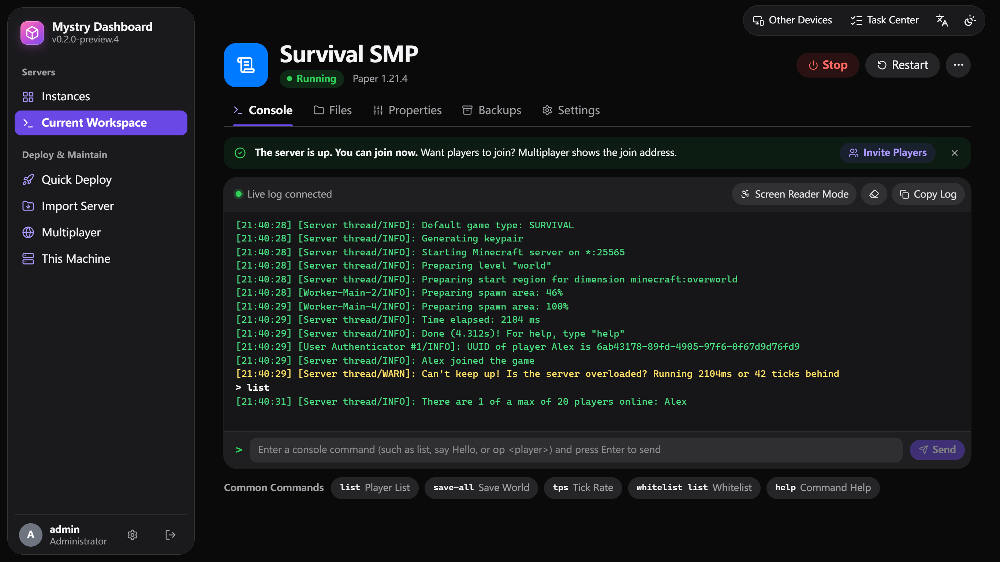
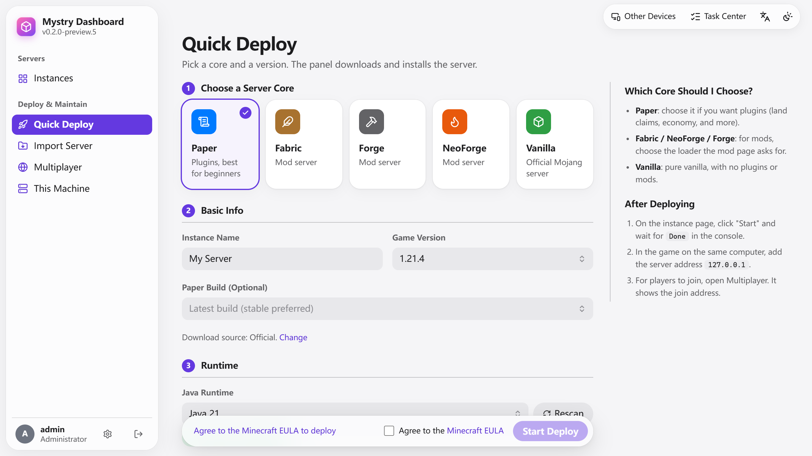
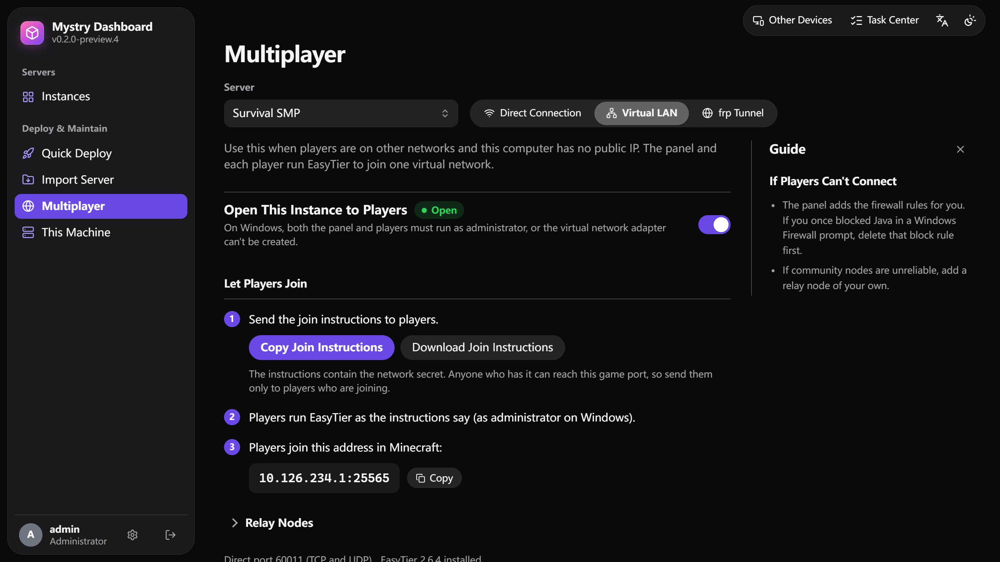

# Mystry Dashboard

**English** · [简体中文](README.zh-CN.md)


**The zero-setup web panel for hosting Minecraft: Java Edition servers on your own machine and playing with friends.**

Deploy a server in a few clicks, watch the live colored console, back up running worlds without stopping play, and let friends outside your home network join through a built-in Virtual LAN — no Docker, no external database, and no public IP required.

Mystry Dashboard is a standalone web application, not a Minecraft mod — it runs on Node.js and does not require Fabric or Forge.

[Quick Start](#quick-start) · [Why Mystry?](#why-mystry-dashboard) · [Features](#features) · [Documentation](docs/README.md) · [Tutorials](docs/tutorials.md) · [Contributing](CONTRIBUTING.md)

> **Preview software.** The current version is `0.2.0-preview.5`. Read [Scope and limitations](#scope-and-limitations) before relying on it in production.

---

## Interface Preview

| Light Appearance · Instances & Live Metrics | Dark Appearance · Live Console & Ready Banner |
|---|---|
|  |  |
| **Quick Deploy · Core Selection & JVM Presets** | **Multiplayer · Built-in Virtual LAN & frp** |
|  |  |

---

## Why Mystry Dashboard?

Most server panels are either heavyweight data-center suites (requiring Linux, Docker, MySQL, Redis and separate daemon agents) or barebones terminal wrappers. Mystry Dashboard is built for **personal, home-lab and friend-group servers**:

- **Unpack and Double-Click to Run** — Portable builds for Windows x64 and Linux x64 bundle Node.js 22 and all production dependencies. Double-clicking `mystryctl.cmd` starts the panel in the background, creates the `admin` account with a random 16-character password shown once in the window, and keeps your servers running even if you close the log window.
- **Play with Friends Without a Public IP** — Built-in **Virtual LAN** (powered by official EasyTier, verified against a pinned SHA-256) puts your server and your friends on an encrypted private network with no port forwarding or account sign-up. It manages scoped Windows Firewall rules automatically and also supports public IPv6 direct connections, custom relay nodes, or your own **frp** server — exposing only the Minecraft game port, never the panel.
- **Automatic Crash Diagnosis & Guided Setup** — Detects common startup failures from the log (unaccepted EULA with a one-click **Accept and Start** button, or Java version mismatches with direct Temurin download links). Includes a structured JVM configurator with G1GC and Paper Aikar presets, plus a grouped `server.properties` form editor that preserves comments and formatting.
- **Live World Backups & Verified Restore** — Create streaming `tar.gz` backups with per-file SHA-256 manifests while a server is running (`save-off` → `save-all flush` → `save-on`). Restores verify every file in a staging folder first and take a `pre-restore` backup by default.
- **Mirror Fallback & Checksum Verification** — Switch between `Official` and `Mainland China Mirror` in **This Machine**. Vanilla version manifests always come from Mojang; mirrored files are used only when their checksum can be verified, and mismatched files are discarded. Multiplayer tools (frp and EasyTier) are checked against pinned SHA-256 hashes and can also be installed from an uploaded archive when GitHub is unreachable.
- **Clean UI & Three Languages** — Built with translucent navigation chrome and card-free content separated by rules and type, supporting `auto` / `light` / `dark` appearances with a fixed ink-purple accent, phone/tablet bottom navigation, and a screen-reader console mode. Loads no external web fonts and is localized in **English**, **Simplified Chinese**, and **Traditional Chinese**.

### How It Compares

| Capability | Raw `.bat` / `.sh` Scripts | Data-Center Panels (e.g. Pterodactyl) | **Mystry Dashboard** |
|---|---|---|---|
| **Setup complexity** | Manual flags, `eula.txt` & port setup | Linux + Docker + MySQL + Redis + Wings | **Single portable folder** (Node.js 22 bundled) |
| **No-public-IP multiplayer** | External tools & manual firewall rules | Not included | **Built-in Virtual LAN (EasyTier) & managed frpc** |
| **Startup error diagnosis** | Raw Java stack traces | Raw console output | **Auto-detects EULA & Java version issues with 1-click actions** |
| **JVM tuning** | Copy-pasting flags by hand | Manual startup string | **Recommended max memory + G1 / Aikar (Paper) presets + argument preview & Java version checks** |
| **Running-server backup** | Manual folder copy (risks corruption) | Varies by storage driver | **Coordinated `save-all flush` + SHA-256 verified `tar.gz`** |
| **Unreliable network fallback** | Manual downloads | Fails on blocked registries | **Official / China mirror switch + SHA-256 verified offline upload** |

---

## Features

| Area | What you can do |
|---|---|
| **Instances** | Create, start, stop, restart, force stop and delete multiple servers on one machine. Dangerous actions require confirmation. |
| **Console** | Live server output with ECMA-48 log-level coloring (`INFO`, `WARN`, `ERROR`), command input, screen-reader mode, and exponential-backoff reconnect. |
| **Files & Properties** | Browse, upload, stream downloads via one-time tickets, edit text files, rename, and edit `server.properties` through a grouped form. |
| **Quick Deploy** | Deploy **Paper**, **Fabric**, **Forge**, **NeoForge** or **Vanilla** (including Minecraft 26.x and legacy versions). Paper and the latest stable release are preselected. |
| **Import Server** | Two-stage ZIP preview & import (inspects `user_jvm_args.txt` before queuing) or safe copy-in from `DATA_DIR/imports` without modifying your original folder. |
| **Backups** | One-click backup of a whole server folder (even while running), download, upload, delete, and atomic staged restore with automatic `pre-restore` backup. |
| **Multiplayer** | Switch between **Direct Connection** (LAN IPv4, public IPv6 and public server addresses), **Virtual LAN** (EasyTier, no public IP needed), and **frp Tunnel**. Only the game port is shared. |
| **Java & JVM** | Scan `JAVA_HOME` and common install paths for verified Java runtimes, pick the right Java for new servers automatically, install a checksum-pinned Eclipse Temurin JRE in one click when it's missing, and configure JVM memory & presets. |
| **Download sources** | Switch between `Official` (default) and `Mainland China Mirror` (BMCLAPI & GitHub mirrors with automatic fallback) in **This Machine**. Vanilla manifests always come from Mojang; mirrored files are used only when their checksum can be verified; frp and EasyTier are checked against pinned SHA-256 values. |
| **Tasks & monitoring** | Global Task Center tracks deploys, imports and backups. **Instances** shows host CPU, memory, free disk space, and per-instance CPU & resident memory. |
| **Appearance & i18n** | Auto / Light / Dark appearance with a fixed ink-purple accent; English (default), Simplified Chinese and Traditional Chinese across UI, server errors and task progress. |

### Supported Games

| Game | Status |
|---|---|
| **Minecraft: Java Edition** | Supported in the current preview |
| **Left 4 Dead 2** | Planned, the first SteamCMD server |
| **Other mainstream SteamCMD dedicated servers** | Planned |

---

## Quick Start

Pick how you want to run Mystry Dashboard, then [sign in for the first time](docs/getting-started.md#set-up-administrator).

| Option | Requirements | How |
|---|---|---|
| **1. Portable preview (Recommended)** | Windows x64 or Linux x64 (Node.js 22 bundled) | [Download, verify and start](docs/portable-release.md) |
| **2. Windows, from source** | Node.js 22 or later | Double-click `PanelManager.cmd` in the repository root |
| **3. Linux / WSL, from source** | Node.js 22 or later | Run `./PanelManager.sh start` |
| **4. Manual development** | Node.js 22 or later, two terminals | [Development guide](docs/development.md) |

### Start in 3 Steps (Source Launcher)

Windows PowerShell:

```powershell
.\PanelManager.cmd start
```

Linux / WSL:

```bash
chmod +x PanelManager.sh
./PanelManager.sh start
```

1. **Launch**: The launcher checks your environment, installs dependencies, generates `config/panel.env` (or `.env` on Windows source) with random secrets, creates the `admin` user with a random 16-character password shown once in the terminal, and starts the panel in the background.
2. **Sign in**: Open `http://127.0.0.1:3000` in your browser and sign in with the credentials shown in the launcher window (you can change the password anytime from the key icon in the bottom-left corner, or reset it locally with `reset-password`).
3. **Deploy & Play**: Open **Quick Deploy**, pick a core and version, check the EULA box, and click **Start Deploy**.

To open the panel on a phone or another computer, click **Other Devices** in the top bar. On a server you reach over SSH, run `./PanelManager.sh remote on`. See [Open the Panel on Another Device](docs/user-guide.md#open-the-panel-on-another-device).

Source launcher commands (`PanelManager.cmd` / `PanelManager.sh`): `start`, `foreground`, `stop`, `restart`, `rebuild`, `status`, `logs`, `open`, `reset-password`, `remote`, `mirror` and `help`. Double-clicking `PanelManager.cmd` without a command opens a menu; `./PanelManager.sh` without a command runs `start`. The portable `mystryctl` has the same commands except `rebuild` and `mirror`, plus two portable-only ones: `watch` (what double-clicking `mystryctl.cmd` does) and `menu`. The source launchers reject `watch` and `menu` as unknown commands.

### Java Requirements for Minecraft

**Java is not bundled.** Install the Java version your Minecraft server needs. By default a server uses the `java` on the panel's `PATH`, or you can select any verified runtime detected by the panel.

| Minecraft version | Recommended Java |
|---|---|
| 26.1 and later | **Java 25** |
| 1.20.5 to 1.21.x | **Java 21** |
| 1.17 to 1.20.4 | **Java 17** |
| 1.16.5 and earlier | **Java 8** |

**Slow dependency downloads?** For source installations, run `.\PanelManager.cmd mirror` or `./PanelManager.sh mirror` to select npm's own config (default), the official registry, or a mainland China mirror (npmmirror, Tencent Cloud, Huawei Cloud). See [npm download source](docs/configuration.md#npm-registry). Portable builds already bundle production dependencies.

### Portable Preview

The release workflow builds self-contained archives for Windows x64 and Linux x64 with Node.js 22, production dependencies, built web assets, SHA-256 checksums, a GPG signature and a CycloneDX SBOM. Check the project's Releases page for published assets, and see the [portable release guide](docs/portable-release.md) for verification and upgrade steps.

### Production Build from Source

After installing dependencies and configuring secrets (see [getting started](docs/getting-started.md)):

```bash
npm run build
npm start
```

On Windows PowerShell, use `npm.cmd` instead of `npm`. Fastify serves the pre-compressed (`.br` / `.gz`) web UI directly.

---

## Configuration

Which config file the panel reads depends on how you run it:

| How you run it | Config file |
|---|---|
| Portable package (`mystryctl`) | `config/panel.env` in the package folder |
| Linux / WSL, from source (`PanelManager.sh`) | `config/panel.env` in the repository |
| Windows, from source (`PanelManager.cmd`) | `.env` in the repository root |
| Manual (`npm run dev:server`, `npm start`) | `.env` in the repository root |

The launchers create the file and generate its secrets automatically. For manual setup, copy [`.env.example`](.env.example).

| Variable | Default | Purpose |
|---|---|---|
| `HOST` / `PORT` | `127.0.0.1` / `3000` | Listen address |
| `MYSTRY_DATA_DIR` or `DATA_DIR` | `data` | Data root (`MYSTRY_DATA_DIR` takes precedence) |
| `BACKUP_DIR` | `DATA_DIR/backups` | Where server backups are stored |
| `JWT_SECRET`, `SETUP_TOKEN`, `LAUNCHER_TOKEN` | generated by the launcher | Three distinct 64-character hex secrets |

Upload sizes, timeouts, concurrency and console limits are all configurable. See [`.env.example`](.env.example) and the [configuration guide](docs/configuration.md) for the full list.

---

## Scope and Limitations

- **Local node only**: Only the built-in local node (`local`) is enabled. Remote agents and multi-node clusters are not enabled yet.
- **Managed instance root**: Every server lives in `instances/<id>` under the data root. The panel never browses arbitrary system paths or binds directly to external directories.
- **Folder import**: To import an existing server, stop it first, then choose its folder in the browser. The panel receives a copy and the original folder is kept untouched. Very large servers can be copied into `DATA_DIR/imports/` instead. See [Upload a Folder](docs/user-guide.md#upload-a-folder).
- **In-memory task queue**: Task metadata is stored in SQLite, while workers run in memory. If the panel restarts, unfinished tasks are marked as failed and their staging folders are cleaned up.
- **Per-instance backups**: Backups cover one server folder at a time. Scheduled backups, retention rules and full-panel database (`panel.db`) backups are not included yet. See [backup and migration](docs/tutorials.md#tutorial-8-backup-and-migration).
- **Multiplayer requirements**: On Windows, Virtual LAN requires starting the panel as administrator, and friends must run their join command as administrator too. When direct P2P fails, encrypted traffic is relayed through shared community nodes (or your custom nodes). frp requires your own frp server. Share the network secret or friend config only with people you trust. See [multiplayer](docs/user-guide.md#multiplayer).
- **Single admin account**: Changing or resetting the password immediately revokes existing tokens, tickets and console connections, but multi-user roles, session listing and 2FA are not implemented yet.

## Security

The panel listens on `127.0.0.1` by default, and access from other devices is something you turn on in the panel. Because it manages server files and spawns Java processes, read the [security policy](SECURITY.md) and the [configuration guide](docs/configuration.md) before exposing it to a network. Never commit `.env`, `config/panel.env`, secrets or the `data/` folder. Please report security vulnerabilities privately via [SECURITY.md](SECURITY.md).

## Project Structure

| Path | Contents |
|---|---|
| `apps/server/` | Fastify 5 API, `node:sqlite`, process, file, backup, LAN/frp and task services |
| `apps/web/` | React 19, Vite 6, React Router 6 and xterm.js |
| `packages/shared/` | Shared TypeScript types, JSON Schemas, JVM presets and i18n message keys |
| `scripts/` | Launchers (`PanelManager`, `mystryctl`), verification scripts and portable packager |
| `docs/` | Bilingual user documentation (`en` & `zh-CN`), architecture/API reference and AI knowledge base |

User documentation ([Documentation Center](docs/README.md), [Getting Started](docs/getting-started.md), [Tutorials](docs/tutorials.md), [User Guide](docs/user-guide.md), [Configuration](docs/configuration.md), [Portable Release](docs/portable-release.md)) is available in both **English** and **Simplified Chinese**. Developer references ([Development Guide](docs/development.md), [API Reference](docs/api.md), [Architecture](docs/architecture.md)), the [Contributing Guide](CONTRIBUTING.md) and the [Changelog](CHANGELOG.md) are available in both languages as well. [CLAUDE.md](CLAUDE.md) and the AI knowledge base in `docs/ai/` are maintained in Chinese. Run the full verification suite with `npm run verify`.

## Roadmap

- Public Minecraft preview with portable Windows x64 and Linux x64 builds
- Scheduled automatic backups and retention policies
- Full support for the mainstream dedicated servers available through SteamCMD, starting with Left 4 Dead 2
- Managing servers on multiple machines from one panel

See the [changelog](CHANGELOG.md) for detailed release history.

## Contributing & Support

Issues, pull requests and documentation improvements are welcome. Please read the [contributing guide](CONTRIBUTING.md) and the [code of conduct](CODE_OF_CONDUCT.md) first.

If Mystry Dashboard makes hosting servers for your friends easier, consider giving the repository a **Star** on GitHub — it helps more players and self-hosters discover the project.

## License

[MIT](LICENSE). Minecraft is a trademark of Microsoft / Mojang. This project is not affiliated with Mojang Studios or Microsoft.
