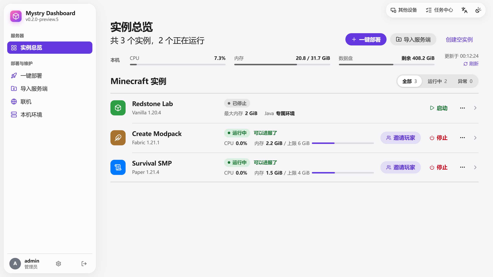
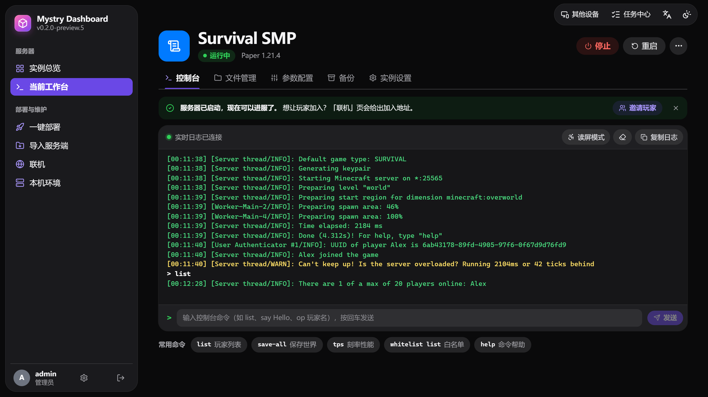

# Mystry Dashboard

[English](README.md) · **简体中文**


**解压即用、自带好友联机的本机 Minecraft Java 服务端管理面板。**

在浏览器里管理多个服务端实例：实时查看着色日志、修改文件与配置、运行中一键备份存档，并用内置虚拟局域网和异地朋友联机——无需配置 Docker 或外部数据库，解压后几分钟就能开好服。

面板本身是独立的 Node.js 程序，不是游戏模组，运行面板不需要安装 Fabric 或 Forge。

[快速开始](#快速开始) · [为什么选择 Mystry？](#为什么选择-mystry-dashboard) · [功能一览](#功能) · [文档中心](docs/README.zh-CN.md) · [分步教程](docs/tutorials.zh-CN.md) · [贡献指南](CONTRIBUTING.zh-CN.md)

> **预览版提示**：当前版本为 `0.2.0-preview.5`。正式投入长期服使用前，请先阅读 [使用边界](#使用边界)。

---

## 界面预览

| 浅色外观（经典蓝）· 实例总览与实时监控 | 深色外观（Mystry 粉）· 实时着色控制台与就绪提示 |
|---|---|
|  |  |
| **一键部署 · 核心选择与结构化 JVM 预设** | **联机 · 内置虚拟局域网（EasyTier）与 frp** |
|  |  |

---

## 为什么选择 Mystry Dashboard？

现有的开服工具往往走两个极端：要么是面向机房的重型集群面板（需要 Linux、Docker、MySQL、Redis 以及分别部署控端与守护进程），要么是简陋的批处理脚本。Mystry Dashboard 面向 **个人开服、好友联机与家用主机自托管** 设计：

- **解压即用，双击启动** — Windows x64 与 Linux x64 便携包已内置 Node.js 22 和全部生产依赖。Windows 下双击 `mystryctl.cmd` 即可在后台启动面板，首次运行会自动生成配置并创建管理员 `admin` 与一次性随机密码；关闭日志窗口不影响面板和服务端运行，重新打开窗口按 `Ctrl+C` 即可安全停止。
- **没有公网 IP 也能异地联机** — 内置 **虚拟局域网（基于固定版本并校验 SHA-256 的官方 EasyTier）** 与 **frp 穿透**。无需公网 IP、无需注册账号，面板会自动生成实例专属的网络密钥并配置对应的 Windows 防火墙规则，同时支持公网 IPv6 直连与自定义中继节点；朋友复制一条命令就能进服，且**只开放游戏端口，不暴露面板**。
- **启动报错自动诊断，参数配置有引导** — 启动失败时自动从日志识别原因：未同意 EULA 时提供一键「同意并启动」，Java 版本不符时直接给出对应版本的 Temurin 下载链接。内置结构化 JVM 参数配置器（含 G1GC 与 Paper Aikar 预设）和保留注释格式的 `server.properties` 表单。
- **运行中在线备份，还原前自动校验** — 服务端运行期间也能一键备份（自动执行 `save-off` → `save-all flush` → 流式打包 `tar.gz` 并写入逐文件 SHA-256 清单 → `save-on`）。还原前先在暂存目录校验全部文件，默认自动备份当前存档，中途出错原目录不受影响。
- **支持国内镜像，下载严格校验** — 在「本机环境」可一键切换「官方来源」或「国内镜像」（BMCLAPI 与公共 GitHub 镜像，失败自动回退官方）。Vanilla 版本清单始终从 Mojang 官方读取；镜像文件只在能核对校验值时使用，不符即丢弃换源；联机工具 frp 与 EasyTier 按固定的官方 SHA-256 校验，连不上 GitHub 时也可上传离线压缩包安装。
- **清爽界面与三语支持** — 导航层毛玻璃，页面内容不堆卡片、用分隔线和字号分层次，提供自动/浅色/深色外观，强调色固定为墨紫，适配手机与平板底部导航栏，并提供控制台读屏模式；不依赖外网字体，离线或国内网络均可正常加载，界面与错误提示完整支持简体中文、繁體中文与 English。

### 方案对比

| 维度 | 传统 `.bat` / 启动脚本 | 机房级面板（如 Pterodactyl 翼龙） | **Mystry Dashboard** |
|---|---|---|---|
| **上手门槛** | 手改脚本、`eula.txt` 与配置文件 | 需 Linux + Docker + MySQL + Redis + Wings | **单压缩包解压双击即用**（内置 Node.js 22） |
| **无公网 IP 联机** | 需自行折腾内网穿透与防火墙 | 无内置，需自行配置网络 | **内置虚拟局域网（EasyTier）与 frpc** |
| **启动崩溃排查** | 满屏英文异常栈自己搜索 | 仅显示原始终端日志 | **自动识别 EULA 未签 / Java 版本不符并一键处理** |
| **JVM 内存与参数** | 手写启动命令，容易配错 | 手填启动字符串 | **按主机内存推荐最大内存 + G1 / Aikar（仅 Paper）预设 + 最终参数预览与 Java 版本检查** |
| **运行中热备份** | 直接复制文件夹（易损毁存档） | 依赖外部存储配置 | **自动同步 `save-all flush` + SHA-256 清单校验** |
| **国内网络可用性** | Forge / 联机工具常卡死 | 强依赖境外源与容器镜像 | **一键切换国内镜像 + 离线包 SHA-256 校验上传** |

---

## 功能

| 能力 | 可以做什么 |
|---|---|
| **实例管理** | 创建、启动、停止、重启、强制停止与删除本机实例，危险操作需确认，启动成功后提示可进服 |
| **控制台** | 查看 ECMA-48 级别着色实时日志（`INFO` 绿、`WARN` 黄、`ERROR` 红）、发送命令、开启读屏模式，断线后指数退避自动重连 |
| **文件与参数配置** | 浏览目录、上传、一次性票据流式下载、在线文本编辑、同目录重命名，通过引导式表单编辑 `server.properties` 与确认 EULA |
| **备份与还原** | 一键备份整个实例目录（运行中也可备份），下载、上传、删除备份；停服后经暂存区校验还原，默认先自动备份当前文件 |
| **一键部署与导入** | 一键部署 **Paper / Fabric / Forge / NeoForge / Vanilla**（含 26.x 年份版本号与 1.7.10 等旧版本）；ZIP 二阶段预检后导入，或从 `data/imports` 复制导入本机已有服务端 |
| **联机** | 在「直接连接」（自动列出局域网 IPv4 与公网 IPv6，也可填公网服务器地址）、「虚拟局域网」（EasyTier，免公网 IP 和账号）与「frp 穿透」间切换；只开放游戏端口，不暴露面板 |
| **Java 与 JVM** | 自动扫描 `JAVA_HOME` 与常见目录中的 Java 运行时，新建服务端时按 MC 版本自动选 Java，缺少时一键安装钉死校验值的 Eclipse Temurin JRE，统一配置内存、预设与高级参数 |
| **下载来源** | 在「本机环境」切换官方来源（默认）或国内镜像（BMCLAPI / GitHub 镜像，自动回退）；Vanilla 清单走 Mojang 官方，镜像文件只在能核对校验值时使用，联机工具支持离线上传压缩包按 SHA-256 安装 |
| **任务与监测** | 顶栏任务中心跟踪部署、导入与备份进度；「实例总览」每 5 秒刷新主机 CPU、内存、数据盘可用空间及各实例进程的 CPU 与驻留内存 |
| **界面与多语言** | 首启自动创建管理员、JWT 登录（改密即刻吊销旧会话）；自动/浅色/深色外观（强调色固定为墨紫）、手机/平板自适应布局，支持简/繁/英三语 |

### 支持的游戏

| 游戏 | 状态 |
|---|---|
| **Minecraft: Java Edition** | 当前预览版已支持 |
| **Left 4 Dead 2（求生之路 2）** | 计划中，首个通过 SteamCMD 支持的服务端 |
| **SteamCMD 上的其他主流服务端** | 计划中 |

### 使用边界

- **单机节点**：当前只管理内置本机节点 `local`，远程 Agent 与多节点集群尚未开放。
- **托管目录隔离**：实例工作目录固定为最终数据根下的 `instances/<id>`；面板不提供全盘浏览或外部目录直接绑定。
- **导入文件夹**：已有服务端先停止，再在浏览器里选它的文件夹上传，面板收到的是一份副本，原目录完整保留；特别大的服务端也可以复制到数据目录的 `imports/` 下导入。步骤见 [上传文件夹](docs/user-guide.zh-CN.md#上传文件夹)。
- **内存任务队列**：任务元数据保存在 SQLite，执行队列在内存；面板重启后，未完成的遗留任务会标记为失败并清理临时文件，不会自动续跑。
- **单实例备份范围**：备份只针对单个实例目录，暂未提供定时自动备份、保留策略以及包含面板数据库 `panel.db` 的整面板备份；整面板迁移见 [备份与迁移](docs/tutorials.zh-CN.md#教程-8备份与迁移)。
- **联机前提**：Windows 上需以管理员身份启动面板才能使用虚拟局域网，朋友也需以管理员身份运行加入命令；直连打洞失败时，流量经社区共享节点（或你填写的自建节点）加密中转；frp 需自备服务器。拿到网络密钥或朋友配置的人都能连上该游戏端口，请只发给信任的朋友。详见 [联机](docs/user-guide.zh-CN.md#联机)。
- **单管理员账号**：修改或重置密码会立即使旧登录令牌、一次性票据与控制台连接失效；多用户权限、会话列表与双重验证（2FA）尚未实现。

---

## 快速开始

先选择运行方式，再按 [初始化管理员](docs/getting-started.zh-CN.md#初始化管理员) 进入面板。

| 运行方式 | 环境要求 | 入口 |
|---|---|---|
| **1. 便携预览版（推荐）** | Windows x64 / Linux x64；**包内自带 Node.js 22** | [下载、校验与启动](docs/portable-release.zh-CN.md) |
| **2. Windows 源码管理器** | Node.js ≥ 22 | 双击仓库根目录 `PanelManager.cmd` |
| **3. Linux / WSL 源码管理器** | Node.js ≥ 22 | 运行 `./PanelManager.sh start` |
| **4. 手动开发** | Node.js ≥ 22，两个开发终端 | [安装与配置](docs/getting-started.zh-CN.md#手动安装与首次配置)、[开发指南](docs/development.zh-CN.md) |

### 3 步启动（源码管理器）

Windows PowerShell：

```powershell
.\PanelManager.cmd start
```

Linux / WSL：

```bash
chmod +x PanelManager.sh
./PanelManager.sh start
```

1. **启动面板**：管理器会自动检查环境、安装依赖、生成带随机密钥的配置文件，并创建管理员 `admin` 和随机 16 位密码（只在窗口里显示一次），随后在后台启动面板。
2. **登录面板**：浏览器打开 `http://127.0.0.1:3000`（手动开发为 `http://127.0.0.1:5173`），用窗口显示的账号密码登录。登录后可点击左下角钥匙图标修改密码；忘记密码时执行 `reset-password` 命令即可在本机重置。
3. **部署开服**：进入左侧「一键部署」，选择服务端核心与版本，勾选同意 EULA，点击「开始部署」。

想用手机或另一台电脑打开面板，点顶栏的「其他设备」；面板在经 SSH 登录的服务器上时运行 `./PanelManager.sh remote on`。详见 [在其他设备上打开面板](docs/user-guide.zh-CN.md#在其他设备上打开面板)。

源码管理器（`PanelManager.cmd` / `PanelManager.sh`）的命令：`start`、`foreground`、`stop`、`restart`、`rebuild`、`status`、`logs`、`open`、`reset-password`、`remote`、`mirror` 和 `help`。不带命令双击 `PanelManager.cmd` 会打开菜单；不带命令运行 `./PanelManager.sh` 等同于 `start`。便携版 `mystryctl` 的命令相同但没有 `rebuild` 和 `mirror`，另有两个便携版专用命令：`watch`（双击 `mystryctl.cmd` 时的默认操作）和 `menu`。源码管理器会把 `watch` 和 `menu` 当作未知命令拒绝。

### Minecraft 所需的 Java 版本

Minecraft 服务端所需的 **Java 需要另行安装**。实例默认使用面板环境 `PATH` 中的 `java`，也可在面板中选择扫描并验证通过的本机运行时。

| Minecraft 版本 | 推荐 Java 版本 |
|---|---|
| 26.1 及更高 | **Java 25** |
| 1.20.5 – 1.21.x | **Java 21** |
| 1.17 – 1.20.4 | **Java 17** |
| 1.16.5 及更早 | **Java 8** |

**依赖下载慢？** 源码管理器用 npm 安装依赖。运行 `.\PanelManager.cmd mirror` 或 `./PanelManager.sh mirror` 可选择下载源：跟随 npm 自身配置（默认）、npm 官方，或国内镜像（npmmirror、腾讯云、华为云），见 [npm 下载源](docs/configuration.zh-CN.md#npm-下载源)。便携版已自带生产依赖，无需设置。

### 便携预览版

发布流程构建 Windows x64 与 Linux x64 两个自包含便携包，内置 Node.js 22、生产依赖和已构建的前后端资源，并附带 SHA-256 校验和、GPG 签名与 CycloneDX SBOM。已发布版本与下载文件见仓库 Releases 页面，签名校验与升级步骤见 [便携预览版说明](docs/portable-release.zh-CN.md)。

### 生产部署（手动构建）

已按 [快速开始](docs/getting-started.zh-CN.md#手动安装与首次配置) 完成依赖安装和密钥配置后，可手动构建并启动：

```powershell
npm.cmd run build
npm.cmd start
```

Linux/macOS 将 `npm.cmd` 换成 `npm`。后端直接托管预压缩（`.br` / `.gz`）后的 Web 页面；配置文件位置、监听地址与资源限制见 [配置说明](docs/configuration.zh-CN.md)。

---

## 数据与安全

最终数据根优先使用 `MYSTRY_DATA_DIR`，其次 `DATA_DIR`，默认是仓库或便携包下的 `data/`。文档中的 `DATA_DIR/...` 均表示最终解析后的数据根，目录结构见 [配置说明](docs/configuration.zh-CN.md#数据目录)。

默认仅监听本机回环地址 `127.0.0.1:3000`，从其他设备访问需要在面板里主动开启。面板具有实例文件读写与进程执行权限，对外访问前请阅读 [安全政策](SECURITY.zh-CN.md) 与 [配置说明](docs/configuration.zh-CN.md)。密钥及运行数据不得提交到仓库。

旧版外部目录的迁移步骤见 [旧版外部实例接管](docs/user-guide.zh-CN.md#旧版外部实例接管)；备份或迁移前请先安全停止实例和面板。

## 项目结构与开发

| 路径 | 职责 |
|---|---|
| `apps/server/` | Fastify 5 API、`node:sqlite`、进程、文件、备份、联机与任务服务 |
| `apps/web/` | React 19、Vite 6、React Router 6 与 xterm.js |
| `packages/shared/` | 前后端共享类型、JSON Schema、JVM 预设与多语言消息键 |
| `scripts/` | 启动器（`PanelManager`、`mystryctl`）、验证与便携打包工具 |
| `docs/` | 中英双语用户文档、开发参考与 AI 知识库 |

用户文档（[文档中心](docs/README.zh-CN.md)、[快速开始](docs/getting-started.zh-CN.md)、[分步教程](docs/tutorials.zh-CN.md)、[使用指南](docs/user-guide.zh-CN.md)、[配置说明](docs/configuration.zh-CN.md)、[便携预览版](docs/portable-release.zh-CN.md)）均提供 **简体中文** 与 **English** 双语版本。开发与实现参考见 [开发指南](docs/development.zh-CN.md)、[API 参考](docs/api.zh-CN.md)、[架构设计](docs/architecture.zh-CN.md) 与 [CLAUDE.md](CLAUDE.md)。完整验证套件可运行 `npm.cmd run verify`（Linux/macOS 为 `npm run verify`）。

## 路线图

- 发布 Windows x64 与 Linux x64 便携预览版
- 定时自动备份与备份保留策略
- 完整支持 SteamCMD 上的主流游戏服务端，先从 Left 4 Dead 2（求生之路 2）做起
- 在一个面板里管理多台机器上的服务端

已发布版本记录见 [变更日志](CHANGELOG.zh-CN.md)。

## 贡献与许可证

欢迎提交 Issue、Pull Request 和文档修正，请先阅读 [贡献指南](CONTRIBUTING.zh-CN.md) 与 [行为准则](CODE_OF_CONDUCT.zh-CN.md)。安全问题请按 [SECURITY.md](SECURITY.zh-CN.md) 私下报告。

如果 Mystry Dashboard 帮到了你和朋友的服务器，欢迎在 GitHub 右上角点一颗 **Star**，让更多服主和自托管玩家看到这个项目。

项目采用 [MIT License](LICENSE)。Minecraft 是 Microsoft / Mojang 的商标；本项目与 Mojang Studios、Microsoft 无官方关联。
