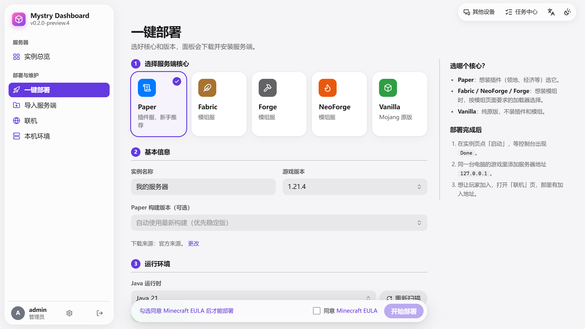
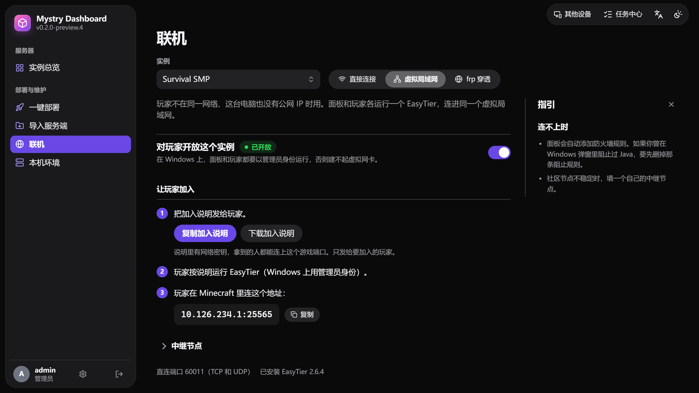

# Mystry Dashboard

[English](README.md) · **简体中文**


**在自己的电脑上开 Minecraft Java 版服务器，让朋友直接进服，全程在浏览器里操作。**


在浏览器里管理多个服务端实例：实时查看着色日志、修改文件与配置、有人在玩时也能备份存档，并用内置虚拟局域网和异地朋友联机。不需要 Docker、外部数据库，也不需要公网 IP。

面板本身是独立的 Node.js 程序，不是游戏模组，运行面板不需要安装 Fabric 或 Forge。

[快速开始](#快速开始) · [功能](#功能) · [文档中心](docs/README.zh-CN.md) · [分步教程](docs/tutorials.zh-CN.md) · [贡献指南](CONTRIBUTING.zh-CN.md)

> **预览版**：长期开服前，请先阅读 [使用边界](#使用边界)。

---

## 适合谁

在自己面前这台电脑上，给自己、家人或朋友开服：

- **解压即用，双击启动** — Windows x64 与 Linux x64 便携包已内置 Node.js 22 和面板需要的全部依赖。Windows 下双击 `mystryctl.cmd` 即可在后台启动面板，窗口里只显示一次管理员 `admin` 的密码；关闭窗口不影响面板和服务端运行，重新打开窗口按 `Ctrl+C` 即可安全停止。
- **没有公网 IP 也能异地联机** — 打开「虚拟局域网」，把加入说明发给朋友即可。不用端口转发、不用注册账号，Windows 防火墙规则由面板自动添加；也支持公网 IPv6 直连、自建中继节点和自己的 **frp** 服务器。只开放游戏端口，不暴露面板。
- **启动失败直接给出办法** — 没同意 EULA 时点「同意并启动」；Java 版本不对时告诉你需要哪个版本，并可一键安装。内存和 JVM 参数用表单配置，带 G1GC 预设，Paper 另有 Aikar 预设。
- **有人在玩也能备份** — 备份时先关闭自动保存、把存档写入磁盘、打包，再恢复保存，不会复制到写了一半的存档。还原前先校验全部文件，并自动备份当前服务端。
- **国内网络也能用** — 在「面板设置」把下载来源换成「国内镜像」；镜像文件只在能核对校验值时使用。连不上 GitHub 时，frp 和 EasyTier 也可以上传离线压缩包安装。
- **手机能用，有深色外观，支持三种语言** — 浅色和深色外观，手机和平板用底部导航，控制台有读屏模式。不加载外网字体，离线也能打开；界面、报错和任务进度都有简体中文、繁體中文和 English。

### 方案对比

| | 启动脚本（`.bat` / `.sh`） | 机房级面板（如 Pterodactyl 翼龙） | Mystry Dashboard |
|---|---|---|---|
| **上手门槛** | 手改启动参数、`eula.txt` 和端口 | Linux、Docker、MySQL、Redis 和 Wings 守护进程 | 一个便携文件夹，内置 Node.js 22 |
| **没有公网 IP 时联机** | 自己配内网穿透和防火墙 | 没有内置 | 内置虚拟局域网（EasyTier）与 frp |
| **运行中备份** | 服务端还在写存档时直接复制文件夹 | 自带备份 | 每次备份前暂停保存并把存档写入磁盘 |
| **国内网络** | 手动下载文件 | 没有内置镜像切换 | 国内镜像并校验文件，或自己上传文件 |

---

## 功能

| 能力 | 可以做什么 |
|---|---|
| **实例管理** | 在本机创建、启动、停止、重启、强制停止与删除多个服务端，危险操作需确认，启动完成后提示可以进服 |
| **控制台** | 按日志级别着色的实时日志、命令输入框、读屏模式，断线后自动重连 |
| **文件与参数配置** | 浏览目录、上传、下载任意大小的文件、在线编辑文本、重命名，用分组表单编辑 `server.properties` 并保留原有注释 |
| **一键部署** | 部署 **Paper / Fabric / Forge / NeoForge / Vanilla**，从 1.7.10 等旧版本到 26.x；默认选中 Paper 和最新稳定版 |
| **导入服务端** | 导入 ZIP 前先看里面有什么，或把已有服务端文件夹复制进来，原目录不会被改动 |
| **备份与还原** | 一键备份整个实例目录（运行中也可以），下载、上传、删除备份；逐个校验文件后再还原 |
| **联机** | 在「直接连接」（局域网 IPv4、公网 IPv6 或公网服务器地址）、「虚拟局域网」（EasyTier，不需要公网 IP）和「frp 穿透」之间切换；只开放游戏端口 |
| **Java 与 JVM** | 找到本机已装的 Java，新建服务端时按 MC 版本选对 Java，缺少时一键安装 Eclipse Temurin，并用 JVM 预设配置内存 |
| **下载来源** | 「官方来源」（默认）或「国内镜像」（BMCLAPI 与 GitHub 镜像，失败时回退官方）；frp、EasyTier 和 Java 下载按固定的 SHA-256 校验 |
| **任务与监测** | 顶栏「任务中心」跟踪部署、导入与备份；「实例总览」显示本机 CPU、内存、可用磁盘空间，以及每个服务端的 CPU 与内存 |
| **账号** | 一个管理员账号 `admin`；修改密码后，其他浏览器和设备需要重新登录 |
| **外观与语言** | 浅色、深色或跟随系统；简体中文、繁體中文与 English，包括服务端报错和任务进度 |

### 截图

| 服务器控制台 | 一键部署 | 联机：虚拟局域网 |
|---|---|---|
|  |  |  |

### 支持的游戏

| 游戏 | 状态 |
|---|---|
| **Minecraft: Java Edition** | 当前预览版已支持 |
| **Left 4 Dead 2（求生之路 2）** | 计划中，首个通过 SteamCMD 支持的服务端 |
| **SteamCMD 上的其他主流服务端** | 计划中 |

---

## 快速开始

先选择运行方式，再按 [初始化管理员](docs/getting-started.zh-CN.md#初始化管理员) 进入面板。

| 运行方式 | 环境要求 | 入口 |
|---|---|---|
| **1. 便携预览版（推荐）** | Windows x64 / Linux x64；**包内自带 Node.js 22** | [下载、校验与启动](docs/portable-release.zh-CN.md) |
| **2. Windows 源码管理器** | Node.js ≥ 22 | 双击仓库根目录 `PanelManager.cmd` |
| **3. Linux / WSL 源码管理器** | Node.js ≥ 22 | 运行 `./PanelManager.sh start` |
| **4. 手动开发** | Node.js ≥ 22，两个开发终端 | [安装与配置](docs/getting-started.zh-CN.md#手动安装与首次配置)、[开发指南](docs/development.zh-CN.md) |

### 3 步从源码启动

Windows PowerShell：

```powershell
.\PanelManager.cmd start
```

Linux / WSL：

```bash
chmod +x PanelManager.sh
./PanelManager.sh start
```

1. **启动面板**：管理器会自动检查环境、安装依赖、生成带随机密钥的配置文件，并创建管理员 `admin` 和随机 16 位密码（只在窗口里显示一次），随后在后台启动面板。
2. **登录面板**：浏览器打开 `http://127.0.0.1:3000`，用窗口显示的账号密码登录。想换成自己的密码，点左下角的齿轮进入「面板设置」，再点「修改密码」；忘记密码时，在本机执行 `reset-password` 命令重置。
3. **部署开服**：进入「一键部署」，选择服务端核心与版本，勾选同意 EULA，点击「开始部署」。

想用手机或另一台电脑打开面板，点顶栏的「其他设备」；面板在经 SSH 登录的服务器上时运行 `./PanelManager.sh remote on`。详见 [在其他设备上打开面板](docs/user-guide.zh-CN.md#在其他设备上打开面板)。

不带命令双击 `PanelManager.cmd` 会打开菜单，`help` 列出全部管理器命令；各命令的作用见 [快速开始](docs/getting-started.zh-CN.md) 与 [便携预览版说明](docs/portable-release.zh-CN.md)。

### Minecraft 所需的 Java 版本

**面板不自带 Java。** 实例默认使用面板环境 `PATH` 中的 `java`，也可以选择面板扫描并验证过的本机 Java。缺少推荐版本时，Java 选择框下方会出现「安装 Java N」，一键把 Eclipse Temurin 装进面板的数据目录。

| Minecraft 版本 | 推荐 Java 版本 |
|---|---|
| 26.1 及更高 | **Java 25** |
| 1.20.5 – 1.21.x | **Java 21** |
| 1.17 – 1.20.4 | **Java 17** |
| 1.16.5 及更早 | **Java 8** |

**依赖下载慢？** 源码管理器用 npm 安装依赖。运行 `.\PanelManager.cmd mirror` 或 `./PanelManager.sh mirror` 可选择下载源：跟随 npm 自身配置（默认）、npm 官方，或国内镜像（npmmirror、腾讯云、华为云），见 [npm 下载源](docs/configuration.zh-CN.md#npm-下载源)。便携版已自带生产依赖，无需设置。

### 便携预览版

发布流程构建 Windows x64 与 Linux x64 两个自包含便携包，内置 Node.js 22、生产依赖和已构建的前后端资源，并附带 SHA-256 校验和、GPG 签名与 CycloneDX SBOM。已发布版本与下载文件见仓库 Releases 页面，签名校验与升级步骤见 [便携预览版说明](docs/portable-release.zh-CN.md)。

### 生产部署（手动构建）

已按 [快速开始](docs/getting-started.zh-CN.md#手动安装与首次配置) 完成依赖安装和密钥配置后，可手动构建并启动：

```powershell
npm.cmd run build
npm.cmd start
```

Linux/macOS 将 `npm.cmd` 换成 `npm`。后端直接托管预压缩（`.br` / `.gz`）后的 Web 页面。

---

## 配置

面板读取哪个配置文件，取决于运行方式：

| 运行方式 | 配置文件 |
|---|---|
| 便携包（`mystryctl`） | 便携包目录下的 `config/panel.env` |
| Linux / WSL 源码管理器（`PanelManager.sh`） | 仓库里的 `config/panel.env` |
| Windows 源码管理器（`PanelManager.cmd`） | 仓库根目录的 `.env` |
| 手动运行（`npm run dev:server`、`npm start`） | 仓库根目录的 `.env` |

管理器会自动创建这个文件并生成密钥；手动配置时复制 [`.env.example`](.env.example)。

| 变量 | 默认值 | 作用 |
|---|---|---|
| `HOST` / `PORT` | `127.0.0.1` / `3000` | 监听地址 |
| `MYSTRY_DATA_DIR` 或 `DATA_DIR` | `data` | 数据根目录（`MYSTRY_DATA_DIR` 优先） |
| `BACKUP_DIR` | `DATA_DIR/backups` | 服务端备份存放位置 |
| `JWT_SECRET`、`SETUP_TOKEN`、`LAUNCHER_TOKEN` | 由管理器生成 | 三个互不相同的 64 位十六进制密钥 |

文档里的 `DATA_DIR/...` 都指最终解析出的数据根目录，目录结构见 [数据目录](docs/configuration.zh-CN.md#数据目录)。上传大小、超时、并发和控制台限制都可以配置，完整列表见 [`.env.example`](.env.example) 与 [配置说明](docs/configuration.zh-CN.md)。

---

## 使用边界

- **单机节点**：当前只管理内置本机节点 `local`，远程 Agent 与多节点集群尚未开放。
- **托管目录隔离**：实例工作目录固定为最终数据根下的 `instances/<id>`；面板不提供全盘浏览或外部目录直接绑定。旧版使用外部目录的实例可以迁入，见 [旧版外部实例接管](docs/user-guide.zh-CN.md#旧版外部实例接管)。
- **导入文件夹**：已有服务端先停止，再在浏览器里选它的文件夹上传，面板收到的是一份副本，原目录完整保留；特别大的服务端也可以复制到数据目录的 `imports/` 下导入。步骤见 [上传文件夹](docs/user-guide.zh-CN.md#上传文件夹)。
- **内存任务队列**：任务元数据保存在 SQLite，执行队列在内存；面板重启后，未完成的遗留任务会标记为失败并清理临时文件，不会自动续跑。
- **单实例备份范围**：备份只针对单个实例目录，暂未提供定时自动备份、保留策略以及包含面板数据库 `panel.db` 的整面板备份；整面板迁移见 [备份与迁移](docs/tutorials.zh-CN.md#教程-8备份与迁移)。
- **联机前提**：Windows 上需以管理员身份启动面板才能使用虚拟局域网，朋友也需以管理员身份运行加入命令；直连打洞失败时，流量经社区共享节点（或你填写的自建节点）加密中转；frp 需自备服务器。拿到网络密钥或朋友配置的人都能连上该游戏端口，请只发给信任的朋友。详见 [联机](docs/user-guide.zh-CN.md#联机)。
- **单管理员账号**：修改或重置密码会立即使旧登录令牌、一次性票据与控制台连接失效；多用户权限、会话列表与双重验证（2FA）尚未实现。

## 安全

默认只监听本机回环地址 `127.0.0.1`，从其他设备访问需要在面板里主动开启。面板能读写服务端文件并启动 Java 进程，对外开放前请阅读 [安全政策](SECURITY.zh-CN.md) 与 [配置说明](docs/configuration.zh-CN.md)。不要提交 `.env`、`config/panel.env`、密钥或 `data/` 目录。安全漏洞请按 [SECURITY.md](SECURITY.zh-CN.md) 私下报告。

## 项目结构

| 路径 | 职责 |
|---|---|
| `apps/server/` | Fastify 5 API、`node:sqlite`、进程、文件、备份、联机与任务服务 |
| `apps/web/` | React 19、Vite 6、React Router 6 与 xterm.js |
| `packages/shared/` | 前后端共享类型、JSON Schema、JVM 预设与多语言消息键 |
| `scripts/` | 启动器（`PanelManager`、`mystryctl`）、验证与便携打包工具 |
| `docs/` | 中英双语用户文档、开发参考与 AI 知识库 |

用户文档（[文档中心](docs/README.zh-CN.md)、[快速开始](docs/getting-started.zh-CN.md)、[分步教程](docs/tutorials.zh-CN.md)、[使用指南](docs/user-guide.zh-CN.md)、[配置说明](docs/configuration.zh-CN.md)、[便携预览版](docs/portable-release.zh-CN.md)）均提供 **简体中文** 与 **English** 双语版本。开发参考（[开发指南](docs/development.zh-CN.md)、[API 参考](docs/api.zh-CN.md)、[架构设计](docs/architecture.zh-CN.md)）、[贡献指南](CONTRIBUTING.zh-CN.md) 与 [变更日志](CHANGELOG.zh-CN.md) 也有中英两版。[CLAUDE.md](CLAUDE.md) 与 `docs/ai/` 下的 AI 知识库用中文维护。完整验证套件可运行 `npm.cmd run verify`（Linux/macOS 为 `npm run verify`）。

## 路线图

- 发布 Windows x64 与 Linux x64 便携预览版
- 定时自动备份与备份保留策略
- 完整支持 SteamCMD 上的主流游戏服务端，先从 Left 4 Dead 2（求生之路 2）做起
- 在一个面板里管理多台机器上的服务端

已发布版本记录见 [变更日志](CHANGELOG.zh-CN.md)。

## 贡献与支持

欢迎提交 Issue、Pull Request 和文档修正，请先阅读 [贡献指南](CONTRIBUTING.zh-CN.md) 与 [行为准则](CODE_OF_CONDUCT.zh-CN.md)。

如果 Mystry Dashboard 帮到了你和朋友的服务器，欢迎在 GitHub 右上角点一颗 **Star**，让更多服主和自托管玩家看到这个项目。

## 许可证

项目采用 [MIT License](LICENSE)。Minecraft 是 Microsoft / Mojang 的商标；本项目与 Mojang Studios、Microsoft 无官方关联。
