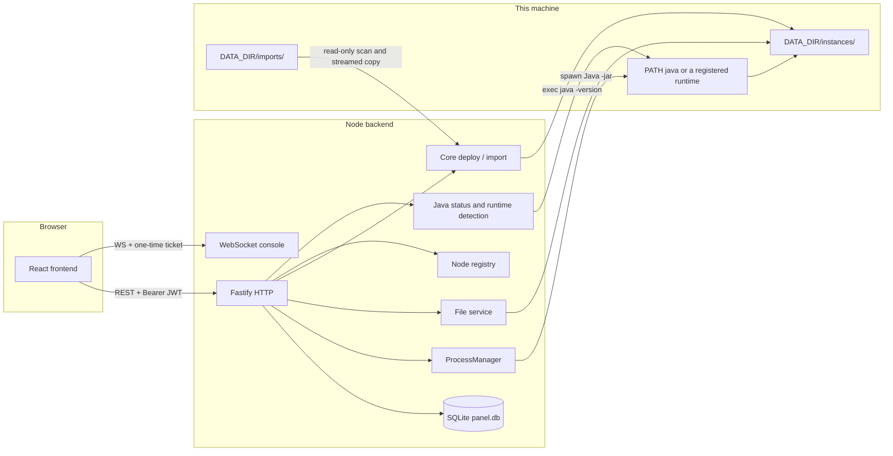

# Architecture

**English** · [简体中文](architecture.zh-CN.md)

## Overview



The core boundary: an instance's only working directory is `DATA_DIR/instances/<id>`. `DATA_DIR` can be relative to the project root or absolute; the instance service, the file service, and deploy and import targets resolve only this managed root. The handoff area for existing servers on the same machine is described in [Instance Directories and Security Boundary](#instance-directories-and-security-boundary), and ZIP preview staging in [Deploy and Import Pipeline](#deploy-and-import-pipeline). Users cannot specify an install directory, and the panel cannot browse directories across the machine. Instances start with the `java` on PATH by default; otherwise they can use, by ID, only a runtime the panel has scanned, registered and re-verifies before execution. Clients cannot submit a path.

Multi-machine support is currently at **phase one**: the built-in local node `local` handles all execution; remote node creation and Agent connections are not open yet (controlled by the shared constant `REMOTE_NODE_CREATION_ENABLED`).

## Monorepo Layout

| Package | Path | Responsibility |
|------|------|------|
| `@mystry/shared` | `packages/shared` | Shared types and interface definitions |
| `@mystry/server` | `apps/server` | API, processes, files, deploy |
| `@mystry/web` | `apps/web` | Management panel UI |

The root `package.json` aggregates `apps/*` and `packages/*` through npm workspaces.

## Portable Release Layout

The portable package does not run from the source directory. `scripts/portable/package-portable.mjs` assembles the following layout natively on the target platform:

```text
mystry-dashboard/
├── runtime/                 # Official Node.js, pinned version
├── app/
│   ├── server/dist/
│   ├── web/dist/
│   ├── shared/dist/
│   ├── mdash.mjs
│   └── node_modules/        # Production dependencies only
├── config/
├── data/
├── logs/
├── mdash.cmd
├── mdash
├── manifest.json
└── VERSION
```

The workspace package `@mystry/shared` is physically copied to `app/node_modules/@mystry/shared`, and the release package rejects symlinks, so a Windows ZIP does not keep a junction pointing back at the build repository. `config/`, `data/` and `logs/` are empty in the release artifact.

In the portable package, `mdash.cmd` and `mdash` only invoke the bundled Node; the Linux / WSL source entry `mdash.sh` first runs the Node version, dependency and build prechecks, then calls the same cross-platform lifecycle controller `scripts/portable/mdash.mjs`. A background start records the PID, a random process fingerprint, the start time and the health URL, and calls the loopback shutdown endpoint with `LAUNCHER_TOKEN`. If the PID has been reused or the health check does not match, the controller does not force-kill the unknown process.

`MYSTRY_HOME` locates the runtime directory; `MYSTRY_CONFIG_PATH` and `MYSTRY_DATA_DIR` can decouple config and data from it. The default instance boundary remains `data/instances/<id>` under the portable root.

## Backend Modules

### Entry `apps/server/src/index.ts`

- Registers CORS, JWT, multipart, WebSocket and static assets (`frontend-assets.ts`: serves the `.br` / `.gz` precompressed copies generated at build time, caches `/assets/*` long-term, and revalidates `index.html` on every request).
- Mounts routes: `auth`, `instances`, `files`, `backups`, `cores`, `console`, `system`, `stats`, `nodes`, `frp`, `lan`, `launcher`.
- Health check: `GET /api/health`.

### Route Layer `apps/server/src/routes/`

| File | Prefix / path | Function |
|------|-------------|------|
| `auth.ts` | `/api/auth/*` | Setup, sign-in, current user |
| `instances.ts` | `/api/instances/*` | CRUD, takeover, start/stop, console commands |
| `files.ts` | `/api/instances/:id/files/*` | Files inside the instance root and `server.properties` |
| `cores.ts` | `/api/cores/*`, `/api/import*` | Version lists, deploy, ZIP import and same-machine directory handoff |
| `console.ts` | `/api/instances/:id/console-ticket`, `/ws/console/:id` | Console ticket and WebSocket |
| `system.ts` | `/api/system/*` | Live host/instance metrics, panel settings, remote access, PATH `java` status and runtime registry |
| `stats.ts` | `/api/stats/overview` | Bucketed resource trends, instance run history, host info and cached disk breakdown |
| `nodes.ts` | `/api/nodes/*` | Local/remote node list and management (phase one) |
| `frp.ts` | `/api/frp/*`, `/api/instances/:id/tunnel` | Multiplayer through the official frpc. Executable paths and raw config are not accepted |
| `lan.ts` | `/api/lan/*`, `/api/instances/:id/lan` | Virtual LAN through the official EasyTier. Executable paths and raw config are not accepted |
| `launcher.ts` | `/api/launcher/shutdown` | Shutdown channel for the local launcher (`mdash`), using a local token |

All route error responses go through `sendRouteError` in `src/http-errors.ts`: known service-layer errors (too many queued tasks, panel shutting down, upload too large, preview expired, rename conflict) map to their own status codes, and everything else uses the route's default status code.

Except for `auth/status`, `auth/setup`, `auth/login`, the health check and the local launcher shutdown channel, all business routes verify the JWT through `authenticate`. `auth/setup` also requires `X-Setup-Token` and is valid only while the users table is empty; the launcher channel (safe shutdown, resetting the admin password) accepts only a loopback address with a valid `X-Launcher-Token`.

### Service Layer `apps/server/src/services/`

| Service | Description |
|------|------|
| `auth-service` | bcrypt passwords, single-user setup |
| `instance-service` | Instance CRUD, managed directory takeover, synced with the DB |
| `process-manager` | PATH or bound-runtime resolution, argument parsing, buffered output, start/stop/restart and final-state snapshots |
| `file-service` | Path normalization inside the instance root, protection against directory escape |
| `config-service` | Parsing and writing `server.properties` |
| `core-depot` | Deploy task orchestration: staging preparation, core fetching, launch target detection, and the common landing/registration wrap-up |
| `core-metadata` | Bounded metadata requests, version lists, download URL resolution and immutable-version cache file names |
| `core-download` | Streaming download, separate part files, merging concurrent requests by cache path, and waiter cancellation |
| `core-installer` | The Forge / NeoForge installer process, output and progress, retry on network failure, cancellation and exit wrap-up, and writing the JVM argfile |
| `core-utils` | The timeout aborter and request User-Agent shared by core downloads and metadata requests |
| `zip-service` | ZIP central directory validation, size-limited JVM argument preview and streaming extraction; preview and extraction share the entry data range validation |
| `import-service` | Schedules ZIP import tasks, flattens a single-directory staging, detects the launch target, lands and registers, and cleans up temp files |
| `import-preview-service` | Manages per-user, time- and count-limited, non-persistent ZIP previews awaiting confirmation |
| `existing-server-import-service` | Enumerates the fixed handoff area, validates read-only and stream-copies existing servers |
| `jvm-detection-service` | Bounded read of `user_jvm_args.txt` in the root, returning structured diagnostics |
| `jvm-validation-service` | Normalizes and re-verifies JVM arguments with the shared rules before saving, before queuing a task and before starting |
| `server-launch-detect` | Detects plain jar and modern Forge/NeoForge args launch targets |
| `task-service` | In-memory task scheduling, persisted state, settling interrupted tasks at startup, and cleaning up half-finished output |
| `backup-service` | Instance backup, upload, restore and delete; pausing autosave for a running server; the directory swap of a restore and its recovery after a crash; deleting scheduled backups beyond the kept count |
| `backup-schedule-service` | One daily backup schedule per instance, stored in `instance_backup_schedules`; a once-a-minute in-process check that queues a due backup through `task-service`, one at a time, and remembers across restarts which day is settled and whether the server has run since |
| `java-detect` | Runs `java -version` and returns availability and version |
| `java-runtime-service` | Scans, verifies and registers Java runtimes, merges refreshes, and re-verifies the bound entry before execution |
| `metrics-service` | Live host and per-process CPU/memory sampling with a 4-second cache, shared between live polling and background collection |
| `run-history-service` | Listens to `ProcessManager` status and `ready` events to persist `instance_runs` and settle open rows as `panel-exit` after an unexpected panel exit |
| `dir-size-scanner` | Hourly asynchronous directory-size walker for `instances` and `backups`, skipping symlinks/junctions, yielding periodically and checking volume boundaries |
| `stats-service` | 5-minute background metric sampling (including host network and disk I/O counters read by `io-counters`), 30-day retention pruning, host OS info and two-layer bucket aggregation for `/api/stats/overview` |
| `node-service` | Node CRUD and secret hashing; remote creation is controlled by `REMOTE_NODE_CREATION_ENABLED` |
| `node-registry` | Node online state / heartbeat (in memory; the local node is always online until the Agent exists) |

### Deploy and Import Pipeline

For a deploy, `core-metadata` resolves versions and URLs, `core-download` manages downloads and the cache, `core-installer` manages the installer, and `core-depot` orchestrates the task. A core file is first written to a separate part file and atomically published to `DATA_DIR/cache/cores/` only once complete; an unfinished file is never reused as cache. Concurrent tasks for the same cache path share one download; one waiter cancelling does not affect the others, and the download is aborted and its part file cleaned up only after all waiters have left; on abort the download leaves the merge table immediately, so later requests start a new download instead of receiving the previous batch's cancel reason.

ZIP preview and extraction both use `zip-service` to validate entry headers and data ranges, and unsupported compression methods are rejected before the file stream is opened; `import-service` handles task queuing and instance landing. A ZIP preview is staged only in `uploads/.tmp-import-preview-*`, bound to the signed-in user and not kept across restarts; once it is confirmed and queued, the import task takes over cleanup.

All deploys and imports finish the same way: "atomic landing from staging → register the instance → update instance metadata". Once the directory has landed, the cancel signal is no longer checked and registration must continue; a worker that returns normally is still recorded as successful. A failure before landing cleans up only the staging; the final instance directory is outside that cleanup.

### Data Layer `apps/server/src/db.ts`

SQLite tables:

- `users` — administrators
- `instances` — instance metadata, jar, JVM arguments, managed state, `node_id`, `java_runtime_id`, etc.
- `tasks` — deploy / import tasks
- `nodes` — execution node metadata and secret hashes (including the built-in `local`)
- `java_runtimes` — Java runtimes the panel scanned and verified, with their current availability
- `instance_backup_schedules` — daily scheduled backup settings and state per instance (cascades on instance delete)
- `instance_runs` — instance start, ready and exit records with end reasons (`stopped`, `crashed`, `start-failed`, `panel-exit`; cascades on instance delete)
- `metric_samples` — 5-minute host (`instance_id IS NULL`) and per-instance CPU and memory samples; host rows also carry network and disk I/O rates in bytes per second (schema version 4), pruned hourly past 30 days (instance rows cascade on instance delete)

The database uses `DatabaseSync` from `node:sqlite` in WAL mode. Instance files are not stored in the database; they all live in `DATA_DIR/instances/<id>`.

The schema version lives in `PRAGMA user_version`. After the data directory lock is taken and before task recovery, `initDb()` passes `PANEL_DB_MIGRATIONS` to the runner in `db-migrations.ts`. Version 1 is the baseline: it brings a database of any earlier shape to the schema as it stood when versioning began, so fresh and old databases take the same path. Each later entry is one step. When steps are pending and the database already has tables, the runner first writes a copy to `DATA_DIR/db-backups/` with `VACUUM INTO`, which includes pages still in the WAL, and keeps the newest five. Each step then runs in one transaction that also sets the version; a failed step rolls back and stops startup. A database newer than the program is refused without being touched.

## Instance Directories and Security Boundary

Default data layout:

```text
DATA_DIR/
├── panel.db
├── db-backups/
├── instances/
│   └── <id>/
├── imports/
│   └── <directory>/
├── cache/cores/
├── frp/<instance id>/
├── lan/<instance id>/
├── runtimes/frp/<version>/
├── runtimes/easytier/<version>/
└── uploads/
```

`defaultInstanceDir(id)` resolves an instance ID to `DATA_DIR/instances/<id>`; file reads, file writes and the process working directory must all pass instance root validation. The `path` the file API receives is a logical path relative to the instance root, and `..` escapes are rejected.

`DATA_DIR/imports` is not an instance root but a fixed handoff area where the administrator places copies of existing servers with system tools. The API accepts no absolute paths and lists only direct subdirectories; the copy task rejects symlinks/junctions, special files, ownership markers, directories over quota and insufficient disk space. The panel never deletes the source directory; when a task fails, it cleans up only the new, half-finished managed instance that carries a valid ownership marker.

### Taking Over Legacy External Instances

Historical records may retain the migration state of a legacy external directory. The panel does not read, scan, move or delete that external directory. The user must first stop the instance and the panel service, copy the complete directory to `DATA_DIR/instances/<id>` with system tools, then call `POST /api/instances/:id/adopt-managed-directory` or use **Take Over Managed Directory** on the instance page. Takeover only confirms and registers the panel-managed copy; the panel never operates on the old location automatically.

## Process Model

For each instance `ProcessManager` maintains:

- A reference to the child process
- The status (matching the frontend `InstanceStatus`)
- A ring text buffer limited by `MAX_CONSOLE_BUFFER_BYTES`

When the child process exits, the active process reference is released, but the `stopped` / `crashed` final state and the last size-limited stretch of console history are kept until the next start or until the instance is deleted, so page refreshes and WebSocket reconnects can read them.

Restarting after a crash is decided outside `ProcessManager`, in `auto-restart-service.ts`. It listens to the status events and, while the panel-wide setting in `panel_settings` is on, reads the instance record again after the saved delay and calls the same `start` as the API, so the instance lock and the start checks are not bypassed. Waiting restarts and the count exist only in memory, and they are dropped as soon as the panel begins shutting down. The conditions are listed under Instances in the [API reference](api.md).

A plain jar launches with:

```text
<PATH java or the bound runtime> <jvmArgs...> -jar <jarFile> nogui
```

The working directory is always `DATA_DIR/instances/<id>`. When unbound, `java` is resolved through PATH in the environment of the process running the panel; when bound, only the runtime matching the registry ID is allowed, and it is re-verified with `-version` before execution. Neither the database nor a request can substitute an arbitrary executable path.

`jvm-config.ts` in the shared package handles parsing direct arguments and Java argfiles, plus the memory formula, versioned presets and structured diagnostics. The database stores no configurator fields; it still stores only the normalized `jvmArgs` string. For a plain jar, the parsed JVM arguments go directly before `-jar`; for Forge / NeoForge, the same normalized arguments are rewritten into `user_jvm_args.txt` before start, then combined with the two panel-controlled argfiles and `nogui`.

Multiplayer tunneling starts a separate official `frpc` child process, with `DATA_DIR/frp/<instance id>` as its working directory and an environment that likewise goes through `getMinecraftChildEnv()`. It exists only while the instance is running with multiplayer enabled, and exits when the instance stops or crashes or the panel shuts down. The panel does not manage frps.

The virtual LAN starts a separate official `easytier-core` child process, with `DATA_DIR/lan/<instance id>` as its working directory and an environment that likewise goes through `getMinecraftChildEnv()`. It exists only while the instance is running with the virtual LAN enabled, and exits when the instance stops or crashes or the panel shuts down. The panel provides no public virtual network and does not accept EasyTier config pasted by users.

## Frontend Structure

| Path | Description |
|------|------|
| `src/App.tsx` | Routing and the sidebar layout |
| `src/auth.tsx` | Sign-in state, setup detection |
| `src/api.ts` | `fetch` wrapper, instance API path encoding, instance start/stop, task polling, authenticated downloads |
| `src/errors.ts` | Turning exceptions into displayable text, and abort detection |
| `src/instance-status.ts` | Glossary keys for instance statuses and which actions are allowed |
| `src/i18n/` | Localization: language detection and switching (`locale.ts`), `useI18n()` and Intl formatting (`index.ts`), and the `en/`, `zh-CN/`, `zh-TW/` string tables split by area |
| `src/components/LanguageToggle.tsx`, `ThemeToggle.tsx` | Language and appearance popovers in the toolbar and login page (sharing `hooks/usePopover.ts`) |
| `src/hooks/*` | Page polling at a common interval (paused while hidden), instance actions, unsaved-change guard, native dialog toggling, metadata loading cached by key |
| `src/pages/*` | The feature pages |
| `src/components/FilesTab.tsx` | Instance file management (list, upload, edit, rename, delete, download) |
| `src/components/ConsolePanel.tsx` | xterm + WebSocket |
| `src/components/JvmSettingsEditor.tsx` | The memory, preset, advanced argument, detection choice and diagnostics UI reused in four places |
| `src/components/EulaCheckbox.tsx` | The EULA acceptance checkbox, likewise reused in four places |

Route table:

- `/login` — sign-in / setup
- `/` — home dashboard: live status blocks with breakdown popovers, CPU/memory trend chart, machine specs (with "Open on other devices" at phone width) and instance activity timeline
- `/instances` — instance list
- `/deploy` — one-click deploy
- `/import` — same-machine directory handoff or zip import
- `/multiplayer` — multiplayer. After choosing an instance, a segmented control switches between the virtual LAN and frp
- `/nodes` — redirects to `/`, where the former local environment page now lives
- `/settings` — panel settings: language and appearance for this device; the panel's session duration, download source and "Open on other devices"; change password; read-only runtime info. Opened from the gear in the user area at the bottom of the sidebar
- `/instances/:id/*` — instance detail tabs

## Authentication Flow

1. `GET /api/auth/status` → `needsSetup`.
2. If setup is needed: `POST /api/auth/setup` with `X-Setup-Token: <SETUP_TOKEN>` → `{ token, user }`.
3. `setup` is accepted only while the users table is empty; `SETUP_TOKEN` can be removed after the administrator is created.
4. Otherwise: `POST /api/auth/login` → `{ token, user }`.
5. Subsequent HTTP requests: `Authorization: Bearer <token>`.
6. The console first gets a one-time ticket with the JWT, then connects through the WebSocket query parameter `ticket`.

## External Dependency APIs

### Download Sources

The panel offers two download sources, "official" and "China mirrors", defaulting to official. The setting is on the "Panel Settings" page and stored in the `panel_settings` table of `panel.db`. The official source never contacts third parties; China mirrors are tried in the order of the table below and fall back to official on failure.

| File | Official source | China mirrors (tried in order) | Verification |
|------|----------|----------------------|------|
| Vanilla version list | Mojang | BMCLAPI → Mojang | None |
| Vanilla version manifest used for deploy | Mojang | Same as official: the manifest is the root of the verification chain and does not use mirrors | — |
| Vanilla version details and jar | Mojang | BMCLAPI → Mojang | Details by the SHA-1 in the manifest, jar by the SHA-1 in the details |
| Paper versions and jar | `fill.papermc.io` | Same as official; there is no reliable mirror | Jar by the SHA-256 from the Fill API |
| Fabric version list | Fabric Meta | BMCLAPI `/fabric-meta` → Fabric Meta | None |
| Fabric server jar | Generated on the fly by Fabric Meta | Same as official; BMCLAPI does not provide it | None |
| Forge version list | `maven-metadata.json` on `files.minecraftforge.net` | BMCLAPI → official | None |
| NeoForge version list | `maven.neoforged.net` | BMCLAPI → official | None |
| Forge / NeoForge installer | Official Maven | BMCLAPI `/maven` → official Maven | By the `.sha256` on the official Maven |
| Installer dependencies and Vanilla jar | Downloaded by the installer itself | The panel prefetches through BMCLAPI first, and the installer fills in what is missing | By the SHA-1 in the installer manifest |
| frpc | GitHub | Nanjing University mirror → `ghfast.top` → `gh-proxy.com` → GitHub | Pinned SHA-256 |
| EasyTier | GitHub | `ghfast.top` → `gh-proxy.com` → GitHub | Pinned SHA-256 |

Rules:

- **No mirrors when the checksum is unknown.** Without a checksum, `createDownloadPlan()` drops all mirror URLs and keeps only the official URL. BMCLAPI's Maven paths redirect to community nodes, and the operators of public GitHub proxies are unknown too, so a file from a mirror is used only if it matches a trusted checksum.
- **Checksums cannot come from community nodes.** On BMCLAPI only the JSON list APIs are answered directly by the main site; `/maven`, `/v1/packages` and `/v1/objects` all 302 to USTC, CERNET or volunteer nodes. Forge / NeoForge `.sha256` files are therefore read only from the official Maven. BMCLAPI likewise 302s the Vanilla manifest to community nodes, so for a deploy the manifest comes only from Mojang (the version list can still use the mirror): the SHA-1 in the manifest verifies the version details, and the SHA-1 in the details verifies the jar, which is what allows the details and jar to use mirrors. The details and jar URLs must be Mojang https URLs, and a manifest or details missing a SHA-1 fails outright instead of falling back to an unverified download.
- **Re-verify before reusing the cache.** The core cache is named only by core type and version, not by source. When the plan carries a checksum, the cache is re-checked against it before every use, and deleted and downloaded again on mismatch; when the plan has no checksum (Fabric, or an installer whose `.sha256` cannot be fetched offline), only non-emptiness is checked.
- **No https downgrade.** When an https URL is requested, the request is rejected if the final URL after redirects is not https, for both metadata and file downloads; only the final URL is checked, so a redirect chain that passes through http and returns to https currently cannot be blocked.
- **Verification happens before writing to the final path.** The digest is computed during the download; on mismatch the file is discarded and the next source tried.
- **List results are not verification.** A version list from a mirror can at worst show wrong versions; it cannot let an unverified file into an instance.
- **BMCLAPI is rate limited.** Measured: more than 10 requests to the same URL within 60 seconds return 429 (2026-11-05; counted per URL, so different files do not affect each other). No waiting is done here: like any other failure, a 429 moves on to the next source.
- While fallback sources remain, waiting for response headers is limited to `CORE_METADATA_TIMEOUT_MS`, so a stalled mirror does not use up the whole download timeout. When every source fails, the error lists each source's reason and suggests changing the source in "Panel Settings".

What still contacts official servers with China mirrors: the installer's `--mirror` does not rewrite `libraries.minecraft.net`, and the NeoForge installer does not use it, so the panel prefetches instead: both installers skip existing files whose SHA-1 matches. On 1.17+, however, the installer still has to download mapping files from Mojang and checks whether the official site is reachable. Fabric and Forge servers may also download files themselves on first start.

Forge / NeoForge are installed with `--installServer`.

Downloaded files can be cached in `DATA_DIR/cache/cores/` to reduce repeated fetches; download size and timeouts are limited by the matching environment variables.

A core cache download is first written to a temp file and atomically published to the final cache path only once it is complete and verified, so a failure, cancel or timeout leaves no reusable partial file. A ZIP import from the Web first creates a non-persistent user preview, consumed only after it is confirmed and the background task is queued successfully; the preview is kept when the queue is full. Deploy / import tasks are scheduled through concurrency slots and a waiting queue, and new tasks are rejected when the queue is full; a task running past the configured timeout is cancelled, and stopping the installer waits `INSTALLER_KILL_GRACE_MS` before a forced kill. Task workers are not resumed across processes; at startup, leftover `pending` / `running` tasks are marked failed, with an attempt to delete the half-finished instance each task was associated with.

HTTP requests and uploads also have total request, connection, keep-alive and upload idle timeouts. An upload over the size limit returns 413, and exhausted upload concurrency or a full task queue returns 429. Instance file downloads are limited to `MAX_CONCURRENT_FILE_DOWNLOADS=4` concurrent slots and return 429 when exhausted; the `FILE_DOWNLOAD_IDLE_TIMEOUT_MS=60000` idle timeout closes the download and releases the slot. The console transport, concurrent connections, command rate, pending stdin input and history output each have their own byte / count limits.

## Type Sharing

`packages/shared/src/index.ts` exports types such as `InstanceInfo`, `DeployCoreInput`, `TaskInfo`, `ConsoleMessage` and `NodeInfo`, plus request body JSON Schemas (such as `createInstanceBodySchema`), shared by Fastify AJV and the TypeScript contract to reduce drift from duplicate definitions in routes.

Build order: **`@mystry/shared` must be built first**, then server / web. Standalone type checking: `npm run typecheck`.
