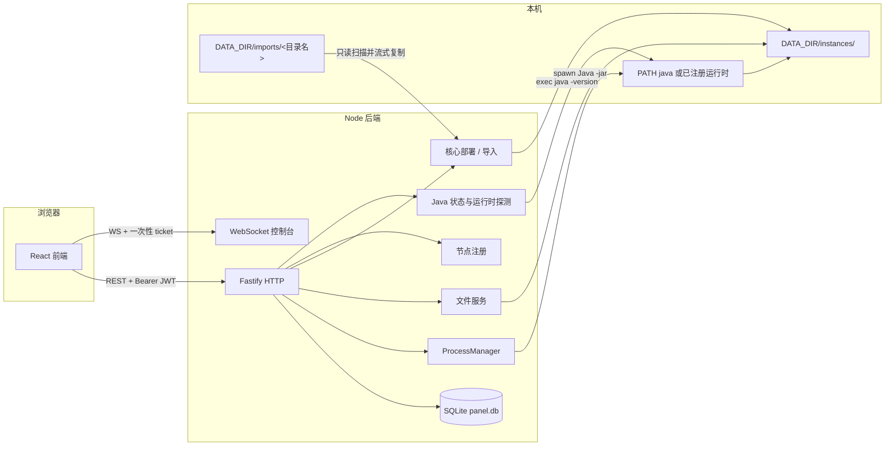

# 架构设计

[English](architecture.md) · **简体中文**

## 总体架构



核心边界：实例的唯一工作目录为 `DATA_DIR/instances/<id>`。`DATA_DIR` 可配置为相对项目根目录的路径或绝对路径；实例服务、文件服务及部署、导入目标仅解析这一托管根目录。同机已有服务端的交接区见 [实例目录与安全边界](#实例目录与安全边界)，ZIP 预览的暂存见 [部署与导入流水线](#部署与导入流水线)。面板不提供用户指定的安装目录，也无法浏览整台机器的目录。实例默认以 PATH 中的 `java` 启动；否则仅能按 ID 使用面板扫描、注册并在执行前复验的运行时，客户端不能提交路径。

多机扩展当前处于**阶段一**：内置本机节点 `local` 承担全部执行；远程节点创建与 Agent 连接尚未开放（由共享常量 `REMOTE_NODE_CREATION_ENABLED` 控制）。

## Monorepo 布局

| 包名 | 路径 | 职责 |
|------|------|------|
| `@mystry/shared` | `packages/shared` | 共享类型与接口定义 |
| `@mystry/server` | `apps/server` | API、进程、文件、部署 |
| `@mystry/web` | `apps/web` | 管理面板 UI |

根 `package.json` 通过 npm workspaces 聚合 `apps/*` 与 `packages/*`。

## 便携发布布局

便携包不从源码目录运行。`scripts/portable/package-portable.mjs` 在目标平台原生组装以下布局：

```text
mystry-dashboard/
├── runtime/                 # 官方 Node.js 固定版本
├── app/
│   ├── server/dist/
│   ├── web/dist/
│   ├── shared/dist/
│   ├── mdash.mjs
│   └── node_modules/        # 仅生产依赖
├── config/
├── data/
├── logs/
├── mdash.cmd
├── mdash
├── manifest.json
└── VERSION
```

工作区包 `@mystry/shared` 以物理复制方式放入 `app/node_modules/@mystry/shared`；发布包拒绝符号链接，以免 Windows ZIP 保留指向构建仓库的目录联接。发布产物中的 `config/`、`data/` 与 `logs/` 为空。

便携包的 `mdash.cmd` 与 `mdash` 仅调用包内 Node；Linux / WSL 源码入口 `mdash.sh` 先完成 Node 版本、依赖与构建预检，再调用同一跨平台生命周期控制器 `scripts/portable/mdash.mjs`。后台启动时记录 PID、随机进程指纹、启动时间与健康地址，并凭 `LAUNCHER_TOKEN` 调用回环关闭接口。若 PID 已被复用或健康检查不符，控制器不会强杀未知进程。

运行目录由 `MYSTRY_HOME` 定位；配置与数据可分别经 `MYSTRY_CONFIG_PATH`、`MYSTRY_DATA_DIR` 与之解耦。默认实例边界仍为便携根目录下的 `data/instances/<id>`。

## 后端模块

### 入口 `apps/server/src/index.ts`

- 注册 CORS、JWT、multipart、WebSocket、静态资源（`frontend-assets.ts`：发送构建时生成的 `.br` / `.gz` 预压缩副本，`/assets/*` 长期缓存，`index.html` 每次重新校验）。
- 挂载路由：`auth`、`instances`、`files`、`backups`、`cores`、`console`、`system`、`stats`、`nodes`、`frp`、`lan`、`launcher`。
- 健康检查：`GET /api/health`。

### 路由层 `apps/server/src/routes/`

| 文件 | 前缀 / 路径 | 功能 |
|------|-------------|------|
| `auth.ts` | `/api/auth/*` | 初始化、登录、当前用户 |
| `instances.ts` | `/api/instances/*` | CRUD、接管、启停、控制台命令 |
| `files.ts` | `/api/instances/:id/files/*` | 实例根目录内的文件与 `server.properties` |
| `cores.ts` | `/api/cores/*`、`/api/import*` | 版本列表、部署、ZIP 导入和同机目录交接 |
| `console.ts` | `/api/instances/:id/console-ticket`、`/ws/console/:id` | 控制台 ticket 与 WebSocket |
| `system.ts` | `/api/system/*` | 实时本机与实例监测、面板设置、远程访问、PATH `java` 状态和本机运行时探测 |
| `stats.ts` | `/api/stats/overview` | 分桶资源趋势、实例运行记录、本机信息与缓存的目录大小拆分 |
| `nodes.ts` | `/api/nodes/*` | 本机/远程节点列表与管理（阶段一） |
| `frp.ts` | `/api/frp/*`、`/api/instances/:id/tunnel` | 官方 frpc 联机。不接受可执行路径或原始配置 |
| `lan.ts` | `/api/lan/*`、`/api/instances/:id/lan` | 官方 EasyTier 虚拟局域网。不接受可执行路径或原始配置 |
| `launcher.ts` | `/api/launcher/shutdown` | 本机启动器（`mdash`）的本机令牌关闭通道 |

路由的错误响应统一经 `src/http-errors.ts` 的 `sendRouteError` 返回：服务层已知错误（排队任务过多、面板正在关闭、上传超限、预览失效、重命名冲突）映射为对应状态码，其余使用路由给定的默认状态码。

除 `auth/status`、`auth/setup`、`auth/login`、健康检查与本机 launcher 关闭通道外，业务路由均经 `authenticate` 校验 JWT。`auth/setup` 另需 `X-Setup-Token`，且仅在用户表为空时有效；launcher 通道（安全关闭、重置管理员密码）仅接受回环地址与有效的 `X-Launcher-Token`。

### 服务层 `apps/server/src/services/`

| 服务 | 说明 |
|------|------|
| `auth-service` | bcrypt 密码、单用户 setup |
| `instance-service` | 实例 CRUD、托管目录接管，与 DB 同步 |
| `process-manager` | 解析 PATH 或已绑定运行时、参数解析、缓冲输出、启停重启与终态快照 |
| `file-service` | 实例根目录内的路径规范化，防止目录逃逸 |
| `config-service` | `server.properties` 解析与写入 |
| `core-depot` | 部署任务编排：准备 staging、获取核心、探测启动目标，以及统一落地/注册收尾 |
| `core-metadata` | 有界元数据请求、版本列表、下载地址解析与不可变版本缓存文件名 |
| `core-download` | 流式下载、独立 part 文件、按缓存路径合并并发请求和等待者取消 |
| `core-installer` | Forge / NeoForge 安装器进程、输出与进度、网络失败重试、取消与退出收尾，以及 JVM argfile 写入 |
| `core-utils` | 核心下载与元数据请求共用的超时中止器和请求 User-Agent |
| `zip-service` | ZIP 中央目录校验、受限 JVM 参数预览和流式解压；预览与解压共用条目数据范围校验 |
| `import-service` | 调度 ZIP 导入任务，整理 staging 单层目录、探测启动目标、落地注册及清理临时文件 |
| `import-preview-service` | 管理按用户隔离、限时限量且不持久化的 ZIP 待确认预览 |
| `existing-server-import-service` | 枚举固定交接区，只读校验并流式复制已有服务端 |
| `jvm-detection-service` | 有界读取根目录 `user_jvm_args.txt` 并返回结构化诊断 |
| `jvm-validation-service` | 使用共享规则在保存、任务入队和启动前规范化与复验 JVM 参数 |
| `server-launch-detect` | 探测普通 jar 与现代 Forge/NeoForge args 启动目标 |
| `task-service` | 内存任务调度、持久化状态、启动中断收敛与半成品清理 |
| `backup-service` | 实例备份、上传、还原与删除；运行中备份时暂停自动保存；还原的目录替换及崩溃后的恢复；删除超出保留份数的定时备份 |
| `backup-schedule-service` | 每个实例一份每日备份计划，存于 `instance_backup_schedules`；进程内每分钟检查一次，到期的备份经 `task-service` 逐个排入，并跨重启记住已处理到哪一天、此后服务器是否运行过 |
| `java-detect` | 执行 `java -version` 并返回可用状态与版本 |
| `java-runtime-service` | 扫描、验证、注册 Java 运行时，合并刷新并在执行前复验绑定条目 |
| `metrics-service` | 实时本机与逐进程 CPU/内存采样，带 4 秒缓存，供页面轮询与后台采集共用 |
| `run-history-service` | 监听 `ProcessManager` 状态与 `ready` 事件持久化 `instance_runs`，并在面板异常退出重启后将遗留记录补全为 `panel-exit` |
| `dir-size-scanner` | 每小时异步统计 `instances` 与 `backups` 目录大小，跳过符号链接/目录联接、分批让出事件循环并判断同卷边界 |
| `stats-service` | 每 5 分钟后台采样、30 天过期清理、本机系统信息读取，以及 `/api/stats/overview` 的两层分桶聚合 |
| `node-service` | 节点 CRUD、密钥哈希；远程创建受 `REMOTE_NODE_CREATION_ENABLED` 控制 |
| `node-registry` | 节点在线态 / 心跳（内存；Agent 接入前本机恒为 online） |

### 部署与导入流水线

部署时，`core-metadata` 解析版本与地址，`core-download` 管理下载与缓存，`core-installer` 管理安装器，`core-depot` 编排任务。核心文件先写入独立的 part 文件，下载完整后才原子发布到 `DATA_DIR/cache/cores/`；未完成的文件不会作为缓存复用。相同缓存路径的并发任务共享同一次下载；单个等待者取消不影响其他等待者，全部退出后才中止下载并清理 part 文件；中止时该下载立即移出合并表，后续请求将重新下载，而不会收到前一批的取消原因。

ZIP 预览与解压统一由 `zip-service` 校验条目文件头与数据范围，不支持的压缩方式在打开文件流前即被拒绝；任务入队与实例落地由 `import-service` 负责。ZIP 预览仅暂存于 `uploads/.tmp-import-preview-*`，绑定登录用户，不跨重启保留；确认入队后由导入任务接管清理。

所有部署与导入统一以「staging 原子落地 → 注册实例 → 更新实例元数据」收尾。目录落地后不再检查取消信号，注册必须继续；正常返回的 worker 仍记为成功。落地前失败仅清理 staging，最终实例目录不在清理范围内。

### 数据层 `apps/server/src/db.ts`

SQLite 表：

- `users` — 管理员
- `instances` — 实例元数据、jar、JVM 参数、托管状态、`node_id`、`java_runtime_id` 等
- `tasks` — 部署 / 导入任务
- `nodes` — 执行节点元数据与密钥哈希（含内置 `local`）
- `java_runtimes` — 面板扫描、验证过的 Java 运行时及当前可用状态
- `instance_backup_schedules` — 每个实例的每日定时备份配置与状态（随实例级联删除）
- `instance_runs` — 实例的启动、就绪与退出记录及结束原因（`stopped`、`crashed`、`start-failed`、`panel-exit`；随实例级联删除）
- `metric_samples` — 每 5 分钟一次的本机（`instance_id IS NULL`）与运行中实例 CPU/内存采样，每小时清理超过 30 天的记录（实例行随实例级联删除）

使用 `node:sqlite` 的 `DatabaseSync`，启用 WAL 模式。实例文件不存入数据库，统一存放于 `DATA_DIR/instances/<id>`。

结构版本记录在 `PRAGMA user_version`。取得数据目录锁之后、恢复任务之前，`initDb()` 将 `PANEL_DB_MIGRATIONS` 交给 `db-migrations.ts` 中的执行器。版本 1 为基线：将此前任何形态的数据库补齐至引入版本号时的结构，因此新库与旧库走同一条路径；其后每一项为一步变更。有待执行的步骤且库中已有表时，执行器先以 `VACUUM INTO` 将副本写入 `DATA_DIR/db-backups/`（包含尚在 WAL 中的页），仅保留最近 5 份；随后每一步在一个事务中完成，并在同一事务内更新版本号，失败即回滚并中止启动。数据库版本高于程序所知时，原样拒绝启动。

## 实例目录与安全边界

默认数据结构：

```text
DATA_DIR/
├── panel.db
├── db-backups/
├── instances/
│   └── <id>/
├── imports/
│   └── <目录名>/
├── cache/cores/
├── frp/<实例 id>/
├── lan/<实例 id>/
├── runtimes/frp/<版本>/
├── runtimes/easytier/<版本>/
└── uploads/
```

`defaultInstanceDir(id)` 将实例 ID 解析为 `DATA_DIR/instances/<id>`；文件读写与进程工作目录均必须通过实例根目录校验。文件 API 接收的 `path` 为相对实例根目录的逻辑路径，`..` 逃逸一律拒绝。

`DATA_DIR/imports` 并非实例根目录，而是固定交接区，供管理员以系统工具放入已有服务端的副本。接口不接受绝对路径，仅列出直接子目录；复制任务拒绝符号链接或目录联接、特殊文件、ownership marker、超出配额的目录，以及磁盘空间不足的情形。面板从不删除源目录；任务失败时，仅清理带有效 ownership marker 的新建托管半成品实例。

### 旧版外部实例接管

历史记录可能保留旧版外部目录的迁移状态。面板不读取、扫描、搬迁或删除该外部目录。用户必须先停止实例与面板服务，以系统工具将完整目录复制到 `DATA_DIR/instances/<id>`，再调用 `POST /api/instances/:id/adopt-managed-directory` 或使用实例页的 **接管托管目录**。接管仅确认并登记面板托管的副本；面板不会自动操作旧位置。

## 进程模型

`ProcessManager` 对每个实例维护：

- 子进程引用
- 状态（与前端 `InstanceStatus` 一致）
- 受 `MAX_CONSOLE_BUFFER_BYTES` 限制的环形文本缓冲

子进程退出后释放活动进程引用，但 `stopped` / `crashed` 终态与末尾一段受限的控制台历史保留至下次启动或实例删除，供页面刷新与 WebSocket 重连读取。

普通 jar 的启动命令形如：

```text
<PATH java 或已绑定运行时> <jvmArgs...> -jar <jarFile> nogui
```

工作目录固定为 `DATA_DIR/instances/<id>`。未绑定时，`java` 经运行面板的进程环境按 PATH 解析；已绑定时，仅允许使用与注册表 ID 对应、且执行前重新通过 `-version` 验证的运行时。数据库与请求均不能将其替换为任意可执行路径。

共享包的 `jvm-config.ts` 负责解析直接参数与 Java argfile，以及内存公式、版本化预设和结构化诊断。数据库不保存配置器字段，仍只保存规范化的 `jvmArgs` 字符串。普通 jar 将解析后的 JVM 参数直接置于 `-jar` 之前；Forge / NeoForge 在启动前将同一组规范化参数重写为 `user_jvm_args.txt`，再与面板控制的两个 argfile 及 `nogui` 组合。

联机穿透另起一个官方 `frpc` 子进程，工作目录为 `DATA_DIR/frp/<实例 id>`，环境同样经过 `getMinecraftChildEnv()`。它仅在实例运行中且已启用联机时存在，随实例停止、崩溃或面板关闭而退出。面板不管理 frps。

虚拟局域网另起一个官方 `easytier-core` 子进程，工作目录为 `DATA_DIR/lan/<实例 id>`，环境同样经过 `getMinecraftChildEnv()`。它仅在实例运行中且已启用虚拟局域网时存在，随实例停止、崩溃或面板关闭而退出。面板不提供公共虚拟网络，也不接受用户粘贴的 EasyTier 配置。

## 前端结构

| 路径 | 说明 |
|------|------|
| `src/App.tsx` | 路由与侧栏布局 |
| `src/auth.tsx` | 登录态、setup 检测 |
| `src/api.ts` | `fetch` 封装、实例接口路径编码、实例启停、任务轮询、认证下载 |
| `src/errors.ts` | 异常转可展示文本与中止判断 |
| `src/instance-status.ts` | 实例状态对应的术语表键与可执行操作判断 |
| `src/i18n/` | 多语言：语言检测与切换（`locale.ts`）、`useI18n()` 与 Intl 格式化（`index.ts`）、按区域拆分的 `en/`、`zh-CN/`、`zh-TW/` 文案表 |
| `src/components/LanguageToggle.tsx`、`ThemeToggle.tsx` | 工具栏与登录页的语言、外观弹层（共用 `hooks/usePopover.ts`） |
| `src/hooks/*` | 统一间隔的页面轮询（隐藏时暂停）、实例操作、未保存修改拦截、原生 dialog 开关、按 key 缓存的元数据加载 |
| `src/pages/*` | 各功能页 |
| `src/components/FilesTab.tsx` | 实例文件管理（列表、上传、编辑、重命名、删除、下载） |
| `src/components/ConsolePanel.tsx` | xterm + WebSocket |
| `src/components/JvmSettingsEditor.tsx` | 四处复用的内存、预设、高级参数、检测选择与诊断界面 |
| `src/components/EulaCheckbox.tsx` | 同样四处复用的 EULA 同意勾选框 |

路由表：

- `/login` — 登录 / 初始化
- `/` — 首页数据看板：实时状态块与详情气泡、CPU/内存趋势图、本机信息（手机宽度下附「在其他设备上打开」）与实例运行时间线
- `/instances` — 实例列表
- `/deploy` — 一键部署
- `/import` — 同机目录交接或 zip 导入
- `/multiplayer` — 联机。选定实例后，以分段控件切换虚拟局域网或 frp
- `/nodes` — 跳转至 `/`，原本机环境页已并入首页
- `/settings` — 面板设置：本设备的语言与外观；面板的登录有效期、下载来源与「在其他设备上打开」；修改密码；只读的运行信息。入口为侧栏底部用户区的齿轮
- `/instances/:id/*` — 实例详情 Tab

## 认证流程

1. `GET /api/auth/status` → `needsSetup`。
2. 若需 setup：`POST /api/auth/setup`，携带 `X-Setup-Token: <SETUP_TOKEN>` → `{ token, user }`。
3. `setup` 仅在用户表为空时受理；创建管理员后可移除 `SETUP_TOKEN`。
4. 否则：`POST /api/auth/login` → `{ token, user }`。
5. 后续 HTTP 请求：`Authorization: Bearer <token>`。
6. 控制台先凭 JWT 获取一次性 ticket，再通过 WebSocket 查询参数 `ticket` 连接。

## 外部依赖 API

### 下载来源

面板提供「官方来源」与「国内镜像」两种下载来源，默认为官方。该设置位于「面板设置」页，保存在 `panel.db` 的 `panel_settings` 表。官方来源绝不访问第三方；国内镜像按下表顺序尝试，失败后回退至官方。

| 文件 | 官方来源 | 国内镜像（依次尝试） | 校验 |
|------|----------|----------------------|------|
| Vanilla 版本列表 | Mojang | BMCLAPI → Mojang | 无 |
| Vanilla 部署用的版本清单 | Mojang | 同官方：清单是校验链的根，不使用镜像 | — |
| Vanilla 版本详情与 jar | Mojang | BMCLAPI → Mojang | 详情按清单中的 SHA-1，jar 按详情中的 SHA-1 |
| Paper 版本与 jar | `fill.papermc.io` | 同官方，无可靠镜像 | jar 按 Fill 接口的 SHA-256 |
| Fabric 版本列表 | Fabric Meta | BMCLAPI `/fabric-meta` → Fabric Meta | 无 |
| Fabric 服务端 jar | 由 Fabric Meta 实时生成 | 同官方，BMCLAPI 不提供 | 无 |
| Forge 版本列表 | `files.minecraftforge.net` 的 `maven-metadata.json` | BMCLAPI → 官方 | 无 |
| NeoForge 版本列表 | `maven.neoforged.net` | BMCLAPI → 官方 | 无 |
| Forge / NeoForge 安装器 | 官方 Maven | BMCLAPI `/maven` → 官方 Maven | 按官方 Maven 的 `.sha256` |
| 安装器依赖与 Vanilla jar | 安装器自行下载 | 面板先经 BMCLAPI 预取，缺失部分由安装器补齐 | 按安装器清单中的 SHA-1 |
| frpc | GitHub | 南京大学镜像 → `ghfast.top` → `gh-proxy.com` → GitHub | 固定的 SHA-256 |
| EasyTier | GitHub | `ghfast.top` → `gh-proxy.com` → GitHub | 固定的 SHA-256 |

规则：

- **校验值未知时不用镜像**。`createDownloadPlan()` 在没有校验值时丢弃全部镜像地址，仅保留官方地址。BMCLAPI 的 Maven 路径会跳转至社区节点，公共 GitHub 代理的运营方亦不可知，因此镜像提供的文件须与可信校验值相符方可使用。
- **校验值不能来自社区节点**。BMCLAPI 仅 JSON 列表接口由主站直接返回，`/maven`、`/v1/packages`、`/v1/objects` 均会 302 至 USTC、CERNET 或志愿者节点。因此，Forge / NeoForge 的 `.sha256` 只从官方 Maven 读取。Vanilla 清单在 BMCLAPI 上同样会被 302 至社区节点，故部署时清单只取自 Mojang（版本列表仍可使用镜像）：清单中的 SHA-1 核对版本详情，版本详情中的 SHA-1 核对 jar，详情与 jar 由此才能使用镜像。详情与 jar 的地址必须是 Mojang 的 https 地址；清单或详情缺少 SHA-1 时直接报错，不退回未校验的下载。
- **缓存复用前复核**。核心缓存仅按核心类型与版本命名，不区分来源。计划带校验值时，每次使用前据此重新核对，不符即删除并重新下载；计划无校验值时（Fabric、离线时无法获取 `.sha256` 的安装器），仅检查文件非空。
- **https 不降级**。请求 https 地址时，若跟随跳转后的最终地址不是 https 即拒绝，元数据与文件下载均如此；仅检查最终地址，途经 http 再回到 https 的跳转链目前无法拦截。
- **校验在写入最终路径之前**。下载时同步计算摘要，不符即丢弃，改用下一个来源。
- **列表结果不算校验**。来自镜像的版本列表至多显示错误的版本，不会让未校验的文件进入实例。
- **BMCLAPI 有限流**。实测同一地址 60 秒内请求超过 10 次即返回 429（2026-11-05；按地址计数，不同文件互不影响）。此处不做等待：429 与其他失败一样，改用下一个来源。
- 尚有后备来源时，等待响应头的时限为 `CORE_METADATA_TIMEOUT_MS`，以免停滞的镜像耗尽整段下载超时。全部失败时，错误信息列出每个来源的失败原因，并提示到「面板设置」更换来源。

使用国内镜像时仍会连接官方的部分：安装器的 `--mirror` 不改写 `libraries.minecraft.net`，NeoForge 安装器亦不使用该参数，因此面板改为预取：两种安装器均会跳过 SHA-1 相符的已有文件。但在 1.17+ 上，安装器仍须从 Mojang 下载映射文件，并检测官方站点能否连接。Fabric 与 Forge 服务端首次启动时也可能自行下载文件。

Forge / NeoForge 以 `--installServer` 完成安装。

下载的文件可缓存于 `DATA_DIR/cache/cores/`，以减少重复拉取；下载大小与超时受对应环境变量限制。

核心缓存下载先写入临时文件，下载完整并通过校验后才原子发布到最终缓存路径；失败、取消或超时均不会留下可复用的部分文件。Web 端 ZIP 导入先创建不持久化的用户预览，仅在确认且后台任务成功入队后才消费；队列满时保留预览。部署 / 导入任务由并发槽位与等待队列调度，队列满时拒绝新任务；任务运行超过配置的超时即被取消，终止安装器时先等待 `INSTALLER_KILL_GRACE_MS` 再强制结束。任务 worker 不跨进程恢复；启动时遗留的 `pending` / `running` 任务转为失败，并尝试删除任务已关联的半成品实例。

HTTP 请求与上传另设总请求、连接、keep-alive 与上传空闲超时。上传超出大小限制返回 413，上传并发容量或任务队列耗尽返回 429。实例文件下载受 `MAX_CONCURRENT_FILE_DOWNLOADS=4` 并发槽位限制，槽位耗尽返回 429；`FILE_DOWNLOAD_IDLE_TIMEOUT_MS=60000` 空闲超时将关闭下载并释放槽位。控制台 transport、并发连接、命令速率、stdin 待处理输入与历史输出各有独立的字节 / 数量上限。

## 类型共享

`packages/shared/src/index.ts` 导出 `InstanceInfo`、`DeployCoreInput`、`TaskInfo`、`ConsoleMessage`、`NodeInfo` 等类型，以及请求体 JSON Schema（如 `createInstanceBodySchema`），供 Fastify AJV 与 TypeScript 契约共用，减少路由内重复定义造成的漂移。

构建顺序：**必须先构建 `@mystry/shared`**，再构建 server / web。独立类型检查：`npm run typecheck`。
