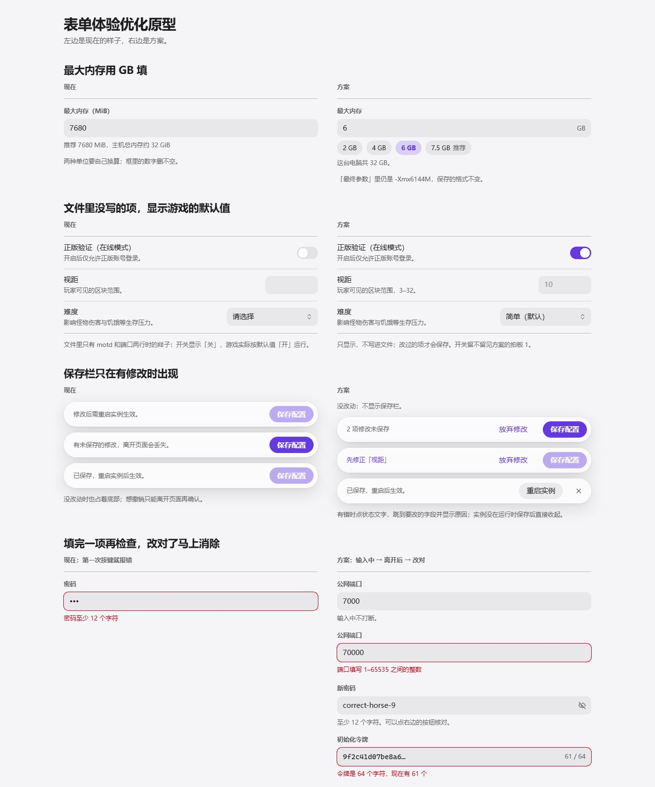
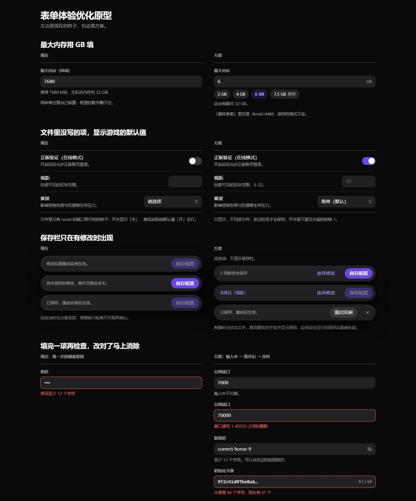

# 表单体验优化：策划案

> 状态：A0、A1 已实现（2026-11-18），第 2 节里这两项写的是改之前的样子；移除名单和默认值已用 1.21.8、1.21.10 官方服务端核对（见第 7 节）。其余各项是方案，等拍板后再排实现。
> 依据：当前 `main`（`0.2.0-preview.4`，`5a1781c`）源码；本机面板在 1366×768 和 375×812 下的实测；业界规范与同类产品调研（第 3 节，逐条带来源，没核实的单独标出）；静态原型 [`form-experience-prototype.html`](form-experience-prototype.html)；Argon 两轮评审（第二轮带原型截图；采纳和没采纳的都写在对应条目里）。若与实现时的源码冲突，以源码为准并修正本文。

## 1. 结论

现有表单的底子是好的，不需要换表单库，也不需要改视觉。要改的是三类问题：

1. **参数配置页显示的不是实际情况。** 这是唯一一类会让用户做错决定的问题，应最先修。它有两层：
   - `server.properties` 没写的项显示成「关」、空白或「请选择」，而游戏实际按自己的默认值运行。本机那个导入的实例，文件里只有两行，页面上「正版验证」显示为关，实际默认是开。
   - 「玩家对战」「允许下界」「生成怪物」「生成动物」四个开关对应的键，新版 Minecraft 已经不读了（前三个从 1.21.9 起改成游戏规则，第四个从 1.21.2 起移除）。部署页默认装最新版，所以新装的服务器上这四个开关拨了也不起作用，页面上看不出来。
2. **同一件事各页做法不一样。** 数字输入有两种写法，报错时机有两种，错误和输入框的关联有的页有、有的页没有，Enter 能不能提交也不统一。原因是没有公共的字段组件（`components/` 下没有任何 `Field` 组件），14 个文件里 41 处 `field` 都是手写的。
3. **几处输入比必要的更费劲。** 内存要按 MiB 填（7680），框里的数字删不空；初始化令牌差一位时按钮只是变灰，不说原因；密码看不到自己输了什么；保存栏没改动时也占着手机屏幕底部 93px。

方案分三档，按成本从低到高排，前两档只动 `apps/web`。

## 2. 现状

### 2.1 已经做对、不要动的

| 做法 | 位置 | 对应的业界做法 |
|---|---|---|
| 标签在输入框上方，说明在下方 | `styles.css` `.field` | GOV.UK、Material 3 的默认排法 |
| 主按钮不可点时，操作栏说出第一个还缺什么 | `DeployPage.tsx:170-178`、`ConfigTab.tsx:295` | 回应了「禁用按钮不说原因」这条最常见的批评（见 3.1 第 4 条） |
| 默认值填好，进部署页不改任何东西就能部署 | `DeployPage.tsx:38-45` | 智能默认值 |
| 高级项收进折叠区，有非默认值时自动展开 | `JvmSettingsEditor.tsx:120` | 渐进展开 |
| 离开有未保存修改的页面会拦住 | `useUnsavedGuard.ts` | Shopify 保存栏的离开确认 |
| 校验规则前后端共用一套说法 | `validation.ts` | — |
| 触屏输入框不小于 16px、点按区域不小于 44px | `design-system.md` | WCAG 2.5.8、iOS 不缩放 |

### 2.2 问题

「证据」一栏的行号都指当前 `main`。

| # | 问题 | 证据 | 影响 |
|---|---|---|---|
| P1a | 参数配置里文件没写的项，显示的不是游戏实际用的值 | `ConfigTab.tsx:198` 把缺失的开关当 `false`；`:212-214` 下拉显示「请选择」；数字框空白。实测：本机导入的实例 `server.properties` 只有 `motd` 和 `server-port` 两行，页面上「正版验证」显示为关、「最大在线人数」空白、「难度」是「请选择」，而游戏默认是正版验证开、20 人、简单。服务端在文件不存在时也只返回 6 个键（`config-service.ts:30-37`、`:312-314`） | 导入的旧服务端和 1.21.8 及更早的新实例最明显：用户看到「正版验证：关」「PVP：关」，以为已经是这样就不动了，实际都开着。新实例启动过一次后游戏会把键补全，问题消失 |
| P1b | 四个开关对应的键，新版本已经不读了 | `ConfigTab.tsx:74`（`pvp`）、`:84-86`（`allow-nether`、`spawn-monsters`、`spawn-animals`）。Minecraft Wiki 的[更新记录](https://minecraft.wiki/w/Java_Edition_25w35a)：`pvp`、`allow-nether`、`spawn-monsters` 在 25w35a（1.21.9）移除，改成游戏规则；[`server.properties` 条目](https://minecraft.wiki/w/Server.properties)：`spawn-animals` 在 24w33a（1.21.2）移除。`ConfigTab` 现在拿不到实例的游戏版本（`InstancePage.tsx:465` 只传了实例 ID） | 部署页默认选最新版（本机看到的是 26.3），新装的服务器上这四个开关拨了、存了也不起作用。来源是社区 Wiki，没有在本机起一个新版服务端验证 |
| P2 | 内存按 MiB 填，说明里又用 GiB | `JvmSettingsEditor.tsx:327-347`；`i18n/zh-CN/jvm.ts:12-14`（「推荐 7680 MiB，主机总内存约 32 GiB」） | 新手要自己换算 |
| P3 | 内存框删不空 | `JvmSettingsEditor.tsx:335-338` 丢掉空值和 0，受控输入框随即弹回原数字（注入输入事件验证：清空后仍是 7680；没有用真键盘再验一遍） | 想把 7680 改成 4096，只能全选后覆盖，按退格删到空会弹回去 |
| P4 | 数字输入有两种写法 | `type="number"`：`ConfigTab.tsx:227`、`JvmSettingsEditor.tsx:330`、`:399`；文本框加 `inputMode="numeric"`：`MultiplayerTab.tsx:363`、`:369`、`:404` | `type="number"` 在桌面上滚轮会改数字，能输入 `e`、`+`、`-`，各浏览器表现不同 |
| P5 | 报错时机不一致 | 初始化页第一个字符就报「密码至少 12 个字符」（`validation.ts:61-63`、`LoginPage.tsx:157`）；改密码对话框等到满 12 位才检查（`ChangePasswordDialog.tsx:94`、`:112`）；其余字段每次按键都检查 | 还在输入就被红字打断 |
| P6 | 初始化令牌不是 64 位时按钮变灰，没有任何说明 | `LoginPage.tsx:36-37` | 复制时少选一位就卡住，而且令牌是密码框，看不到自己贴了什么。这和规范第 156 行「说出缺什么」不符 |
| P7 | 密码框没有显示按钮 | `LoginPage.tsx:133-143`、`ChangePasswordDialog.tsx:72-109`、`MultiplayerTab.tsx:417` | 12 位以上的密码盲打容易错；改密码因此多了一个「确认新密码」框 |
| P8 | 错误和输入框的关联有的有、有的没有 | 有：`DeployPage.tsx:241-245`（`aria-describedby` 指向错误）；没有：`MultiplayerTab.tsx:364`、`:392`、`:400`、`:405`、`:418`，`ChangePasswordDialog.tsx:111-112` | 读屏用户到了输入框听不到错误原因 |
| P9 | 多数表单没有 `<form>` | 有：登录、导入、文件对话框；没有：部署、实例设置、参数配置、frp 服务器；改密码自己监听 Enter（`ChangePasswordDialog.tsx:52-56`） | 在输入框里按 Enter 有的页能提交、有的不能 |
| P10 | 保存栏没改动时也一直在 | `ConfigTab.tsx:293-300`、`InstancePage.tsx:260-271`。375×812 下实测保存栏高 93px，再加底部标签栏，一个不可点的按钮占掉底部约 190px；栏里的「修改后需重启实例生效」和页首那句重复 | 手机上一个点不了的按钮常驻占掉 93px（屏高的一成多）；想撤销修改只能离开页面再确认丢弃 |
| P11 | 参数配置的开关要点保存才生效 | `ConfigTab.tsx:192-202`；规范第 124 行写的是「Switch applies immediately; checkbox is submitted」 | 和自己的规范、和联机页的开关（立即生效）不一致。单看这一条不算严重，叠上 P10（保存栏平时就在、状态变化不显眼）才容易让人以为拨了就生效 |
| P12 | 保存后只说「重启实例后生效」，不给重启入口 | `i18n/zh-CN/config.ts:11` | 实例在运行时，用户要回到页头找重启 |
| P13 | 可选项的标法不统一 | 只有部署页的加载器标了「（可选）」（`DeployPage.tsx:286`）；frp 表单的「访问地址」可选但没标，缺必填项时在按钮旁写一句（`MultiplayerTab.tsx:429-432`） | 用户不知道哪些可以跳过 |
| P14 | 部署页 Java 版本不符时，同一件事说了三遍 | Java 选择框下、第 4 节（`DeployPage.tsx:362-366`）、操作栏 | 选择框下和操作栏各说一遍是合理的（一个在字段旁，一个在按钮旁）；多余的是第 4 节，它在这种情况下只为重复这句话而出现 |
| P15 | 服务端报的错不带字段 | `packages/shared/src/messages/index.ts:64-68` 的 `ApiErrorBody` 只有 `error`、`code`、`params` | 「端口被占用」这类只有服务端知道的错只能显示在页面底部，不能标在对应输入框上 |

## 3. 业界做法与同类产品

来源分两种可信度：标「已复核」的是我自己打开原文核对过引文的；其余由调研代理打开页面读过，我没有逐条复核。代理没读到正文的，列在 3.3。

### 3.1 规范怎么说

| # | 做法 | 来源 | 对应本方案 |
|---|---|---|---|
| 1 | 数字不要用 `type="number"`，用 `inputmode="numeric"`；单位放在输入框的前后缀里，但读屏不读后缀，标签或说明里也要有单位；不要拦粘贴 | [GOV.UK Text input](https://design-system.service.gov.uk/components/text-input/)（已复核） | A2、A3 |
| 2 | 字段还没输完不要检查；离开字段时检查；已经报错的字段要按键级别重新检查，改对的那一下错误就消失 | [Baymard：Inline Form Validation](https://baymard.com/blog/inline-form-validation)（已复核）；[NN/g](https://www.nngroup.com/articles/errors-forms-design-guidelines/) | A4 |
| 3 | 密码默认隐藏、带显示按钮；始终允许粘贴；`autocomplete` 用 `new-password` / `current-password`；不需要「确认密码」第二个框 | [GOV.UK Password input](https://design-system.service.gov.uk/components/password-input/)（已复核）；[web.dev](https://web.dev/articles/sign-in-form-best-practices)；[WCAG 3.3.8](https://www.w3.org/WAI/WCAG22/Understanding/accessible-authentication-minimum.html) | A5、拍板 4 |
| 4 | 禁用按钮：GOV.UK「尽量避免」；Carbon 分情况：短表单在条件满足前禁用，长表单不要禁用，理由是「错误信息和主按钮可能不在同一屏」；Smashing：非禁用不可时，要说明为什么、怎么解决 | [GOV.UK Button](https://design-system.service.gov.uk/components/button/)、[Carbon Forms](https://carbondesignsystem.com/patterns/forms-pattern/)（均已复核）；[Smashing](https://www.smashingmagazine.com/2021/08/frustrating-design-patterns-disabled-buttons/)；[Adam Silver](https://adamsilver.io/blog/the-problem-with-disabled-buttons-and-what-to-do-instead/) | A7、拍板 3 |
| 5 | 开关应立即生效，不该再要点保存；做不到立即生效就换成复选框或单选 | [NN/g Toggle Switch](https://www.nngroup.com/articles/toggle-switch-guidelines/)（已复核） | P11、拍板 1 |
| 6 | 文本框、复选框组、原生下拉用显式保存；开关、分段控件用自动保存；同一个表单里不要混用；一页只有一个保存按钮 | [Primer Saving](https://primer.style/product/ui-patterns/saving/)（已复核） | P11、A6 |
| 7 | 保存栏在有未保存修改时自动出现，带「保存」和「放弃」；此时点别处导航会被拦住 | [Shopify Save Bar](https://shopify.dev/docs/api/app-bridge-library/web-components/ui-save-bar)（已复核） | A6 |
| 8 | 提交失败后给出错误汇总，把焦点移过去，每条链接到对应字段；错误不能只靠颜色 | [GOV.UK Error summary](https://design-system.service.gov.uk/components/error-summary/)；[WCAG 3.3.1](https://www.w3.org/WAI/WCAG22/Understanding/error-identification.html) | A7、C1 |
| 9 | 标签在输入框外面、上方，不拿占位字当标签 | [NN/g](https://www.nngroup.com/articles/form-design-placeholders/)；[Material 3](https://m3.material.io/components/text-fields/guidelines) | 现状已符合；A1 的占位字只用来显示默认值，标签仍在 |
| 10 | 表单以单列为主，只有强相关的短字段可以同行 | [Baymard](https://baymard.com/blog/avoid-multi-column-forms)；[Primer](https://primer.style/product/ui-patterns/forms/) | 现状是「名称 + 版本」「内存 + 优化方案」同行，属于允许的情况；本方案不新增并排字段 |
| 11 | 步进按钮只适合小幅微调，范围大的数值要能直接输入 | [NN/g Input Steppers](https://www.nngroup.com/articles/input-steppers/) | A3 用档位加输入框，不用步进器 |

### 3.2 同类产品怎么做

| 产品 | 做法 | 来源 | 可借鉴 / 要避开 |
|---|---|---|---|
| Pterodactyl | 启动变量没有保存按钮，按键后约 500 毫秒自动保存；按校验规则推导控件（布尔是开关、枚举是下拉） | [VariableBox.tsx](https://raw.githubusercontent.com/pterodactyl/panel/1.0-develop/resources/scripts/components/server/startup/VariableBox.tsx) | 避开：输到一半就可能存进去。这是「不做即改即存」的一个理由 |
| Pelican | 建服是三步向导；变量的默认值显示成占位字；资源限制先选「不限 / 限制」再出数字框 | [CreateServer.php](https://raw.githubusercontent.com/pelican-dev/panel/main/app/Filament/Admin/Resources/Servers/Pages/CreateServer.php)、[StartupVariable.php](https://raw.githubusercontent.com/pelican-dev/panel/main/app/Filament/Components/Forms/Fields/StartupVariable.php) | 借鉴：默认值作占位字（A1）。向导不借鉴，它面向的是管理员给别人开服 |
| AMP | 内存按 MB 填，官方指南要专门解释「1 GB 填 1024」 | [配置指南（官方论坛）](https://discourse.cubecoders.com/t/minecraft-java-edition-server-configuration-guide/5648) | 避开：这正是 P2 |
| Modrinth App | 内存滑块有常用吸附点；设置项旁有「恢复默认」；按 Minecraft 版本提示推荐的 Java；默认内存按机器内存给 | [更新日志](https://modrinth.com/news/changelog?filter=app) | 借鉴：常用档位（A3）。推荐 Java 和按机器给默认内存本面板已有 |
| Aternos / exaroton | 选项用大白话命名（Slots、Fly、Monsters），每项一句说明；危险项单独写后果；页面写明改动要重启才生效 | [Aternos](https://support.aternos.org/hc/en-us/articles/360030513552-The-options-of-your-server-explained)、[exaroton](https://support.exaroton.com/hc/en-us/articles/360019857698-The-options-of-your-server-explained) | 本面板参数配置已经是这个做法 |
| Crafty Controller 4 | 建服页把内存和端口放在最下面；配置页是一长页原始字段 | [建服](https://docs.craftycontrol.com/pages/user-guide/server-creation/minecraft/)、[配置](https://docs.craftycontrol.com/pages/user-guide/server-config/minecraft/) | 没有可借鉴的 |
| MCSManager | 手动建服要自己写含 `-Xmx` 的启动命令，再去上传核心、手改 `eula.txt` | [文档](https://docs.mcsmanager.com/setup_java_edition.html) | 本面板的部署页已经好过它 |
| Railway | 改动先暂存，横幅显示改了几项，可以看差异、逐条放弃，再一次性生效 | [Staged changes](https://docs.railway.com/guides/staged-changes) | 借鉴：保存栏写「N 项修改未保存」并能放弃（A6） |
| VS Code 设置 | 搜索即筛选；改过的项有标记；可只看改过的；逐项恢复默认；改动立即生效 | [文档](https://code.visualstudio.com/docs/configure/settings) | 它有几百项才需要搜索，本面板 20 项，见「不做」 |

### 3.3 来源之间的分歧，以及没核实的

- **必填怎么标**：GOV.UK 只标可选；NN/g 要求必填全标星号；Baymard 两种都标；Carbon 标少数的那一类。这里必填项占多数，已有「（可选）」的写法，所以取 GOV.UK / Carbon 的做法（A8）。
- **禁用主按钮**：见 3.1 第 4 条。没有一份规范明确认可「禁用，但在常驻的操作栏里说明原因」；它回应了 Carbon 反对长表单禁用的那条理由（原因和按钮始终在同一屏），但这是我的推断。
- **校验时机**：GOV.UK 默认只在提交时校验；NN/g、Baymard、Carbon 主张失焦时；Apple HIG 主张输入时。本方案取失焦时。
- **保存方式**：Primer 要显式保存；VS Code、Pterodactyl 即改即存。
- **保存按钮要不要常驻**：[Grafana 的设计规范](https://github.com/grafana/design-system/blob/main/docs/06-patterns/save.mdx)要求保存按钮一直在、没改动时禁用，这正是本面板现在的做法；Shopify 是有改动才出现。A6 取后者，理由是手机上的占位（P10），见拍板 2。
- **没核实**：Aternos 的选项是不是开关、是不是立即生效（帮助文章没写）；Discord 设置页「开关加保存栏」的做法是我的印象，这次没有找到可引用的官方说明；1Panel、Vercel、Linear、PufferPanel 的表单没读到正文；「reward early, punish late」的原始出处没打开。

## 4. 方案

原型里能看到第一档里看得见的那几条：[`form-experience-prototype.html`](form-experience-prototype.html)（左边现在，右边方案；地址后加 `#dark` 看深色）。截图见附录。

### 第一档：只改 `apps/web`，一条一条能单独做

| # | 改动 | 解决 | 做法 | 工作量 |
|---|---|---|---|---|
| A0 | 参数配置：这个版本不读的项不显示 | P1b | `FieldMeta` 加「从哪个版本起移除」；`InstancePage` 把实例的游戏版本传给 `ConfigTab`。版本已知且不低于移除版本时不显示这一行；文件里还留着这个键时，主列表和「高级选项」都不显示它，保存时原样保留。版本未知（自定义 Jar）时照旧显示。在该组末尾加一句说明：「玩家对战、下界、怪物生成在这个版本改用游戏规则（`/gamerule`）设置」。不写具体命令：规则的名字各版本不一样（Wiki 记的是 1.21.9 用驼峰写法，之后又改过），写死了会教错。名单和分界版本以第 7 节的实机核对为准。**已实现**（`ConfigTab.tsx` 的 `removedIn`、`gameRuleNote`），实际文案按分组各写一句。实机核对：1.21.8 生成的文件有 `pvp`、`allow-nether`、`spawn-monsters`、没有 `spawn-animals`，1.21.10 四个都没有；具体从 1.21.9、1.21.2 起移除这两个分界版本仍取自 Wiki。1.21.2 到 1.21.8 只少「生成动物」一项，它没有变成游戏规则，这段版本不显示说明 | 小 |
| A1 | 参数配置：文件没写的项显示游戏默认值 | P1a | `FieldMeta` 加 `defaultValue`。开关按默认值显示；数字和文本框用默认值做占位字（世界种子写「留空则随机生成」）；下拉显示「简单（默认）」而不是「请选择」。只显示、不写文件。「有没有改过」的判断要跟着改，针对文件里原本没有的键：开关和下拉没有「空」这个状态，值等于默认值时不算改动、也不进保存内容，否则开关拨过去再拨回来会一直显示「有未保存的修改」（现在 `ConfigTab.tsx:166-176` 只在值为空串时才这么处理）；数字和文本框留空表示用默认值、算合法，用户亲手填了值（哪怕等于默认值）就算改动并写进文件，删空则回到没改。**已实现**（`ConfigTab.tsx` 的 `defaultValue`、`placeholderKey` 和 `setValue`），世界种子的占位字是「随机」；默认值已和 1.21.8、1.21.10 生成的文件逐项核对一致（18 项；`spawn-animals` 两个版本都没有这个键、没核对到，世界种子没有默认值）。文件里写了键但值留空时按实测显示：下拉项和数字按默认值，开关按「关」，文本就是空的（不显示占位字） | 小 |
| A2 | 数字输入统一成文本框加 `inputMode` | P3、P4 | 全部改为 `type="text" inputMode="numeric"`（小数用 `decimal`）。每次按键只要能解析成合法数字就立刻交给表单，输入框另留一份字符串草稿，只用来容纳「空」和「4.」这类中间状态；必填的数字（内存、端口）这时算不合法，可以留空的（参数配置里用默认值的项、Paper 构建号）留空算合法。失焦只整理显示，不改数值。这样不等失焦就点保存或按 Enter，拿到的也是最新值。粘贴时去掉首尾空格和千分位逗号 | 小，随 B2 做 |
| A3 | 内存用 GB 填 | P2 | 输入框右侧带「GB」；下面一排常用档位（沿用 `chip`），按主机内存过滤，现有算法给出的推荐值那一档用 `chip-desc` 标「推荐」；说明只写「这台电脑共 32 GB」。填的 GB 乘 1024 后取整成 MiB（`buildJvmArgs` 本来就取整）。读屏不读后缀，所以「GB」要用 `aria-describedby` 挂到输入框上。保存的仍是 `-Xmx6144M`，「最终参数」预览不变；初始内存（Xms）只换单位，不加档位。已有的值不是整数 GB 时（比如导入的 `-Xmx2500M`）显示成最多两位小数（2.44），用户不动这个框就原样保留，不四舍五入后写回 | 中 |
| A4 | 报错时机统一：填完一项再检查，改对了马上消除 | P5 | 「合不合法」和「显不显示红字」分开算：前者每次按键都算，决定主按钮和操作栏；后者只在字段失焦过、按过 Enter 或点过操作栏状态之后才显示。已经在报错的字段每次按键重新检查。空的必填项仍然不标红（规范第 156 行不变）。「放弃修改」要同时清掉草稿和这些标记 | 中，随 B1 做 |
| A5 | 密码和令牌可以看 | P6、P7 | 密码框右侧加显示/隐藏按钮；初始化令牌改成等宽字体的普通文本框（它本来就是从配置文件里复制的），框内右侧实时显示「61 / 64」，不用失焦就能看出少贴了几位；失焦后仍不够时再说「令牌是 64 个字符，现在有 61 个」 | 小，随 B2 做 |
| A6 | 保存栏只在有修改时出现，并加「放弃修改」 | P10、P11、P12 | 实例设置和参数配置两页：没改动时不显示；有改动时显示「2 项修改未保存」加「放弃修改」「保存」；保存成功且实例在运行时，变成「已保存，重启实例后生效」加「重启实例」（仍走现有的重启确认）和一个关闭按钮，再次修改或离开本页也会收起。页面内容的最底下一直留一段和保存栏等高的内边距（只在滚到底时看得到，不占屏幕），栏出现和消失时内容不跳、最后一行不被挡。手机上状态文字单独一行，「放弃修改」和「保存」在第二行并排；「已保存」那一态文案缩短，保持一行。`ConfigTab` 现在只拿到实例 ID，要从 `InstancePage` 传入运行状态和重启动作。部署和导入页是新建流程，操作栏照旧常驻 | 中 |
| A7 | 操作栏的状态文字可以点，跳到要改的字段 | P14 | 「先修正『视距』」「先安装或选择 Java 25」做成 `link-button`，点了滚动到该字段、聚焦，并让它显示具体的错误原因（见 A4）。部署页第 4 节不再重复 Java 那句话，只留进度和失败原因 | 小 |
| A8 | 可选项统一标「（可选）」，必填项不标 | P13 | 沿用已有的 `deploy.form.optionalLabel` 写法，补到 frp「访问地址」等可选项上 | 小，随 B1 做 |

### 第二档：公共字段组件（只动 `apps/web`，但要逐页迁移）

| # | 改动 | 解决 | 做法 | 工作量 |
|---|---|---|---|---|
| B1 | `Field` 组件 | P8，并承载 A4、A8 | 一个组件负责标签、`id`、「（可选）」、说明、错误行和 `aria-describedby` / `aria-invalid`，内部记住字段是否失焦过。类名还是现在的 `field`、`field-help`、`error`，外观不变 | 中 |
| B2 | `NumberField`、`PasswordField` | 承载 A2、A5 | 在 `Field` 上各加一层；`NumberField` 支持单位后缀。内存的 GB 换算和档位只有 JVM 配置器一处用，直接写在 `JvmSettingsEditor.tsx` 里，不抽公共组件 | 小 |
| B3 | 表单统一用 `<form>` 提交 | P9 | 部署、实例设置、参数配置、frp 服务器、改密码改成 `<form onSubmit>`；主按钮 `type="submit"`，其余按钮保持 `type="button"`。注意主按钮禁用时浏览器不会因为 Enter 触发提交（登录页的注释 `LoginPage.tsx:34-35` 记过这一点），所以表单还要自己接 Enter：不合法时让有问题的字段显示原因，并滚动、聚焦到第一个，和点操作栏状态（A7）是同一个动作 | 小 |
| B4 | 逐页迁移 | — | 顺序：改密码（最小）→ frp 服务器 → 实例设置 → 部署 → 导入 → 参数配置 → 远程访问。每迁一页补一条 `test:interaction` | 大，可分多次提交 |

不引入表单库：校验规则已经在 `validation.ts` 里和服务端对齐，字段数量也不多，自己写的 `Field` 一两百行就够；换库要重写全部表单的状态，收益对不上成本。

### 第三档：要动 `packages/shared` 和服务端（建议暂缓）

| # | 改动 | 解决 | 做法 | 工作量 |
|---|---|---|---|---|
| C1 | 服务端错误可以带字段 | P15 | `ApiErrorBody` 加可选的 `field`；`PanelError` 支持传字段名；前端有 `field` 时把错误标到对应输入框并聚焦，没有时照旧显示在底部。要同步 `docs/api.md` | 中 |

C1 只有在确实存在「只有服务端才知道、又能对应到某个字段」的错误时才值得做。目前想得到的只有端口冲突和 Jar 文件不存在，格式和范围类的错误前端已经先拦住了。建议这次不排，等前两档做完、这类错误在实际使用里确实常见再说。

### 建议的顺序

1. A0、A1：修的是显示错误，独立、最小。
2. B1、B2、B3：三个小组件加 `<form>`，同时带上 A2、A4、A5、A8，先落在改密码和登录页。
3. A3：落到 JVM 配置器，部署、两种导入、实例设置四个入口一起生效。
4. A6、A7：落到实例设置、参数配置和部署页。
5. B4：把剩下的页迁完。

## 5. 不做

- **换表单库**（react-hook-form、Formik、zod 等）：理由见第二档。
- **把部署页拆成多步向导**：现在不改任何东西就能部署，拆成几步反而多点几次；编号小节加常驻操作栏已经给了顺序感。
- **全站改成即改即存**：文本和数字项要等输完才能存，还要处理每项各自的失败；参数配置改完本来就要重启才生效，分批保存更符合用户的预期。
- **把登录页的浮动标签推广到其他表单，或反过来把登录页改掉**：登录页只有两三个字段，是有意做成一组的；其他表单字段多、有说明，标签在上方更稳。
- **内存只用滑块**：滑块拖不准具体数字，要配输入框；档位按钮加输入框已经够用。
- **参数配置加搜索、逐项「恢复默认」**：收录的常用项只有 20 个，四组两栏一屏多一点就能看完；真要做，只该做在「高级选项」那个未收录键的列表上。
- **密码强度条**：规则只有长度，一句「至少 12 个字符」比一根彩色条清楚。
- **内存旁边画一条「占这台电脑多少」的进度条**：原型第一版画过，Argon 指出它和档位、说明里的数字重复，而且真实页面里内存和「优化方案」并排，左边会比右边高出一倍。已从方案和原型里去掉。
- **Ctrl+S 保存**（Argon 的建议）：会盖掉浏览器自己的「保存网页」，对新手没有明显好处；有了 `<form>` 之后在输入框里按 Enter 就能保存。

## 6. 需要拍板

1. **参数配置的开关（P11）怎么处理。** 这一条规范和评审意见相反，两边都写出来：
   - 甲（建议，前提是做 A6）：保留开关和显式保存。一动开关，保存栏立刻出现并写明「1 项修改未保存」，离开页面还有确认。同时把规范第 124 行改成「开关立即生效；在带保存栏的设置列表里，改动随保存栏一起提交」。Argon 支持这一项，理由是这一页是「左边标题和说明、行末一个控件」的设置列表，行末放一个没有文字的复选框会像「勾选这几行做批量操作」，而且这一页的改动本来就要重启才生效，没有哪一项是立即生效的。局限：NN/g、Primer 都不认可这种用法，支持它的先例（Discord 的设置页）这次没有核实到出处。
   - 乙：按 NN/g、Primer 和现在的规范第 124 行，换成复选框。改动最小，不用改规范；代价是上面说的行末复选框的观感，要做得好得把这 9 行改成「复选框在左、文字在右」，和同组的数字、下拉行排法不一样。
   - 丙：参数配置改成即改即存。和「不做」里的第三条冲突，工作量最大。
2. **保存栏要不要改成有修改才出现（A6）。** 这会改掉规范里的现行写法：第 130 行「One per page, sticky at the bottom」、第 152 行「Form pages put the main action in an `.action-bar`」，两处都要加上「编辑已有设置的页面，没改动时不显示」。业界两种做法都有（Shopify 有改动才出现，Grafana 常驻并禁用）。建议改，只限实例设置和参数配置两页；如果不改，A6 里的「放弃修改」和「重启实例」仍然可以单独加到常驻的栏里。
3. **主按钮不可点的做法要不要保留。** 建议保留，并做 A7。理由和它的局限见 3.3 第二条。
4. **改密码要不要去掉「确认新密码」。** GOV.UK 和 web.dev 都说有了显示按钮就不需要第二个框。建议随 A5 一起去掉；初始化页本来就只有一个密码框。
5. **第三档 C1 做不做。** 建议这次不排。
6. **原型文件要不要留在仓库。** 这个是静态页，写死了类名和结构，样式一改就会走样。建议方案定下来之前留着，实现合入后连同截图一起删，只留本文。

## 7. 验证方式

实现时每条按 [`verification.md`](../ai/verification.md) 的「UI/样式」一行走，另外：

- A0、A1：用一份只有几行的 `server.properties`（导入的旧服务端）和一个没启动过的新实例各看一遍，确认显示的是默认值，且不改任何东西时不出现保存栏。动手前先各起一个 1.21.8 和最新版的服务端，拿它们自己生成的 `server.properties` 核对「哪些键还在、默认值是多少」，不要只凭 Wiki 或记忆；20 个收录项都过一遍，不只是这次查到的四个。（2026-11-18 已核对：从 Mojang 官方清单下载 1.21.8、1.21.10 服务端并校验 SHA-1，用 JDK 21 首次运行生成 `server.properties`。收录项里有默认值的 18 项全部一致（`spawn-animals` 的默认值没核对到，世界种子没有默认值）；`pvp`、`allow-nether`、`spawn-monsters` 只在 1.21.8 里有，`spawn-animals` 两个版本都没有。1.21.10 上还试了空值：`difficulty=`、`gamemode=`、`max-players=` 等被改写回默认值，`online-mode=` 被写成 `false`，`motd=`、`level-name=` 保持为空；文件里多写的 `pvp=false` 会被保留、不会被删。没核对的：1.21.9 和 1.21.2 这两个分界版本本身、26.3（官方清单写明要 Java 25，本机最高是 JDK 21，跑不了）、1.13 及更早的旧版本；空值的表现只在 1.21.10 上试过。另用临时数据目录的测试面板在 26.1、1.21.10、1.21.8 和版本未知四种实例上看过显示和保存。）
- A2、A3：用真键盘试删空、退格、粘贴「4096」「4,096」「4g」；手机上确认弹出的是数字键盘。
- A4：键盘从头 Tab 到尾，确认没填过的必填项不变红。
- A6：有修改时点侧栏其他页，确认离开确认还在；保存时断网，确认保存栏留着并显示错误。
- B1 迁移的每一页：`test:interaction` 加一条「错误行有 `id`，输入框的 `aria-describedby` 指向它」。
- 三档截图：1920×1080、1366×768、390×844；深色和英文各补一档。

## 附录：原型截图

原型是静态页，直接用浏览器打开 [`form-experience-prototype.html`](form-experience-prototype.html)。它只画了看得见的四处（内存、默认值、保存栏、报错时机），交互没有做。除了 `styles.css` 里已有的类，方案只新增三处样式：带单位或按钮的输入框（`input-affix`）、选中的档位（`chip.is-selected`，用 `accent-soft-strong`）、操作栏里可点的状态文字（沿用 `link-button`）。

下面三张用无头 Chrome 截取，都是整页长图：

| 1366 宽，浅色 | 1366 宽，深色 | 390 宽，浅色 |
|---|---|---|
|  |  |  |
