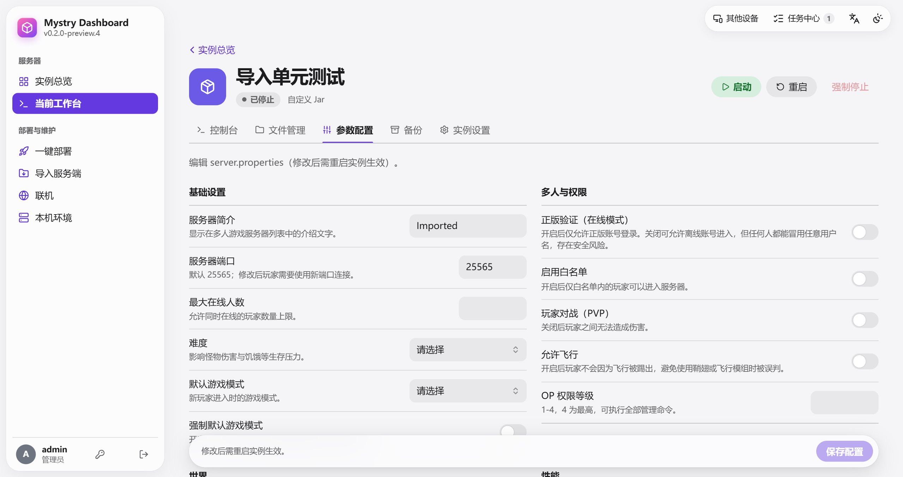
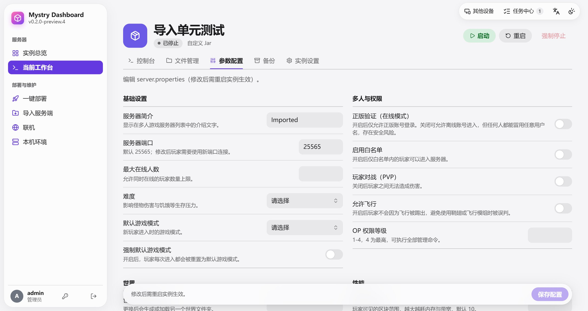
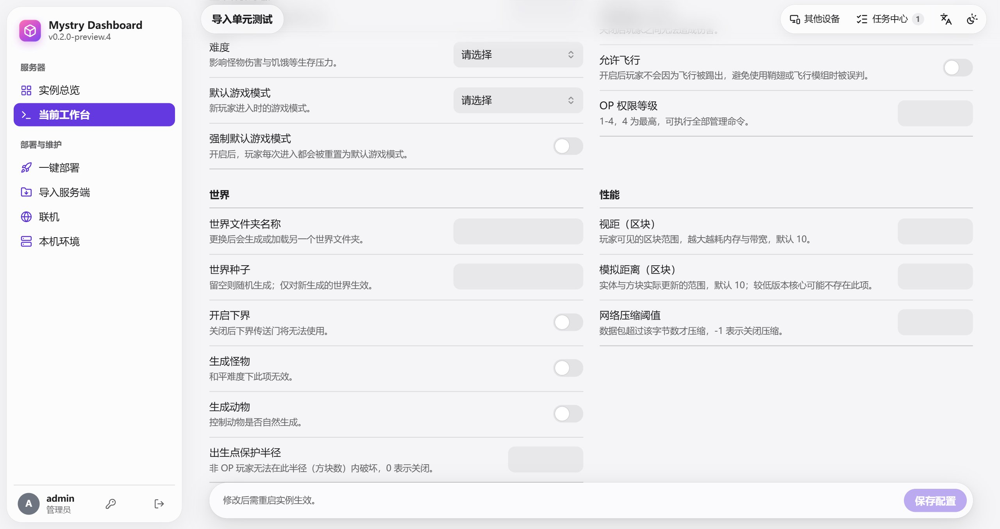
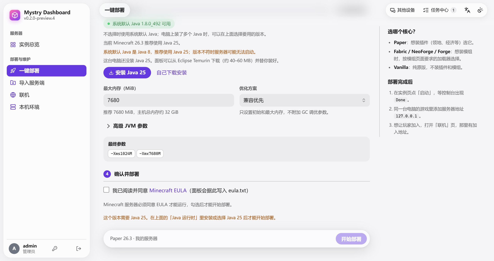
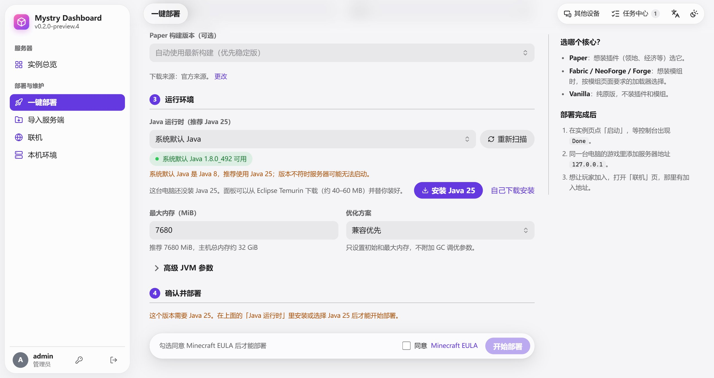
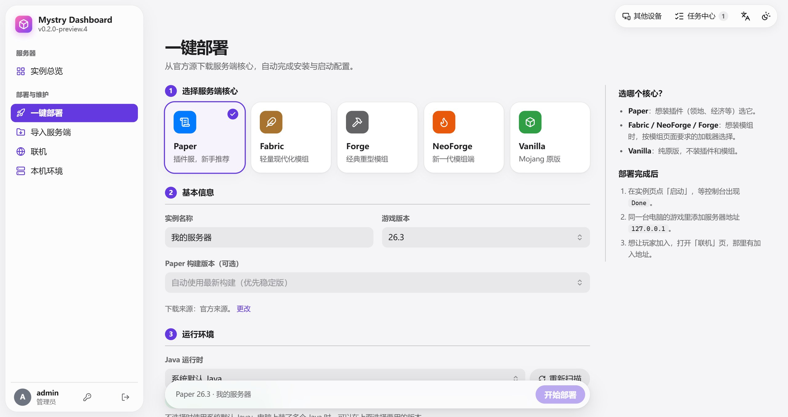
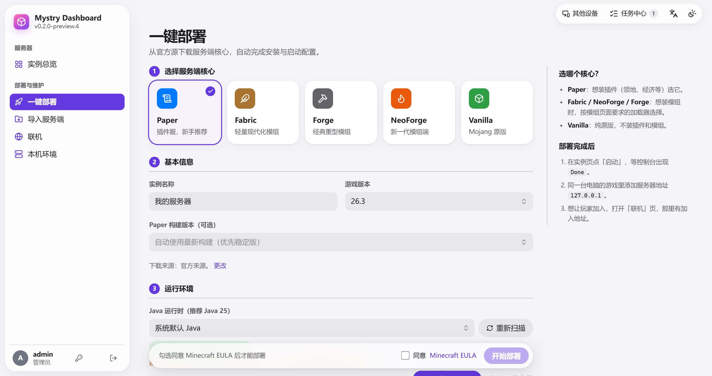

# 矮屏减少滚动：策划案

> 状态：四条都已实现（2026-11-18），触发高度按 820px。下文保留方案原文；实现与本文不同处以源码为准。
> 依据：当前 `main`（`0.2.0-preview.4`）源码；在用户笔记本的网页区尺寸（1463×775）下的实测；浏览器原型 [`vertical-density-prototype.js`](vertical-density-prototype.js)；Fable 与 Argon 两轮评审。若与实现时的源码冲突，以源码为准并修正本文。

## 1. 问题

用户的笔记本是 2560×1600、系统缩放 175%，浏览器最大化后网页区约 **1463×775** CSS 像素，比常见的 1366×768 笔记本（网页区约 650 高）还宽裕，但很多页面仍要频繁滚动。实测（测试数据只有一个实例，真实数据只会更长）：

| 页面 | 内容高度 | 约几屏 |
|---|---|---|
| 一键部署 | 1449 | 1.9 |
| 实例 → 参数配置 | 1315 | 1.7 |
| 导入服务端 | 890 | 1.1 |
| 实例 → 实例设置 | 813 | 1.05 |
| 本机环境 | 790 | 1.02 |
| 总览、联机、控制台、文件、备份 | 775 | 一屏 |

高度主要花在三处：

1. **实例页顶部**：顶栏 60px → 「‹ 实例总览」返回链接一行 → 图标与 30px 实例名、状态行 → 标签栏，五个标签页的内容都要从第 301px 才开始，屏幕上方约四成被固定占用。
2. **部署页「运行环境」一节**：Java 运行时下面 5 行说明，加上一直展开的「最终参数」预览，一节就有 544px；必须勾选的 EULA 在页面最底下。
3. **整体留白**：页面区块间距 24px、顶栏 60px 等在矮屏上累加。

换成 1920×1080、缩放 100% 的屏幕（网页区约 950 高），部署页和参数配置页也仍要滚动，所以要改排版，不是只靠换屏。

## 2. 范围

| # | 内容 | 章节 | 原型实测（1463×775，逐条单独打开） |
|---|---|---|---|
| 1 | 实例页头收紧；滚动后顶栏标题显示实例名 | 3 | 参数配置的内容起点 301 → 254px |
| 2 | 矮屏（且是桌面宽度）自动收紧间距 | 4 | 部署页少 30px；参数配置起点 301 → 280px |
| 3 | JVM「最终参数」进折叠区；Java 说明去重 | 5 | 部署页少 171px |
| 4 | 部署页的 EULA 同意项移进底部操作栏 | 6 | 部署页少 82px，不用滚到底就能勾选和部署 |

四条合计：一键部署 1449 → 1166px（约 1.5 屏，Java 版本不符的情形；版本对得上时第 4 节整节不出现，会更短）；参数配置的内容起点 301 → 235px，总长 1315 → 1245px（见附录最后一行）。

本文截图都用无头 Chrome 按用户屏幕截取：视口 1463×775 CSS 像素、设备缩放 175%，图片是 2560×1356 实际像素，浅色。

**不做**：

- **标签栏吸顶**：原型做过，两位评审都反对。矮屏上常驻约 40px，和省高度的目标相反；不透明整宽横条违反「导航层用玻璃、顶栏不画整宽硬边横条」；键盘焦点可能被它遮住。
- **全局改成紧凑**（Argon 的建议）：会改变高屏用户已定稿的观感，只对矮屏生效更稳。
- **矮屏把页面大标题降到 22px**：22px 是区块标题和总览状态句的档位，降下来层级就乱了。
- **用户可选的密度开关**：多一个设置项，每页都要在两种密度下测；四条做完仍不够时再议。
- **CSS 整体缩放、字号低于 13px**：字会发糊，违反规范的最小字号和触控尺寸。
- **短字段改双列**（Argon 的建议）：部署页的名称与版本、内存与优化方案已经并排，参数配置已经是两栏，没有可改的。

## 拍板结果

四条都做，第 2 条触发高度用 820px（用户的网页区是 775，1920×1080 缩放 100% 约 950，不会触发）。

实现后实测（无头 Chrome，浅色）：

| 尺寸 | 顶栏 | 一键部署总长 | 参数配置内容起点 | 参数配置总长 |
|---|---|---|---|---|
| 1463×775（用户） | 56 | 1449 → 1168 | 301 → 235 | 1315 → 1245 |
| 1366×768 | 56 | 1192 | 235 | 1245 |
| 1920×1080 | 60（不触发矮屏档） | 1196 | 255 | 1269 |

## 3. 实例页头收紧

**改什么**

- 侧栏常驻时（宽度 ≥1025px，与侧栏变抽屉的断点一致）隐藏「‹ 实例总览」返回链接，侧栏里有「实例总览」。≤1024px 时保留，因为那时侧栏收进抽屉。
- `.instance-header` 的行间距去掉，实例名与状态行间距 8 → 4px。图标、实例名字号、启停按钮都不动。
- 滚动后顶栏的标题胶囊显示**实例名**，现在显示「实例工作台」。实例名比「实例工作台」更有用：滚下去以后用户需要知道自己在改哪个实例。
- 标签栏不吸顶，切换标签靠回到顶部。

**怎么实现**

- 返回链接和间距只改 `styles.css`「实例工作台」一节。
- 顶栏标题由 `App.tsx` 的 `pageTitleKeyFor()` 按路由给出固定文案，拿不到实例名。加一个很小的 context（例如 `ToolbarTitleContext`）：`InstancePage` 拿到实例后设置标题，卸载时清空；`App.tsx` 有值时用它，没有时照旧用路由文案。实例名是用户自己起的名字，不进 i18n。

**风险**

- 隐藏返回链接后，从总览进来的人要用侧栏或浏览器后退回去。侧栏在 ≥1025px 时一直可见，风险低。
- 超长实例名在胶囊里已有省略号处理（`.toolbar-title` 是 `text-overflow: ellipsis`）。

**原型截图**（1463×775，浅色）

| 改前 | 改后 | 改后滚动 |
|---|---|---|
|  |  |  |
## 4. 矮屏自动收紧

**条件**：`@media (max-height: 820px) and (min-width: 1025px)`。只写高度条件会命中横屏手机、平板和软键盘弹起时的视口，布局会跳，所以必须加宽度条件。

**改什么**

| 项 | 现在 | 矮屏 |
|---|---|---|
| 顶栏高度 `--toolbar-height` | 60px | 56px（窄屏已用这个值；52px 时里面 42px 的胶囊只剩 5px 余量） |
| 内容区顶部留白 | 顶栏 + 6px | 顶栏 + 2px |
| 页面区块间距 `.page` | 24px | 18px |
| 实例页区块间距 `.instance-page` | 20px | 14px |
| 页头上内边距 `.page-header` | 6px | 0 |
| 表单区块内间距 `.form-section` | 10px | 8px |
| 页面大标题 | 30px | **不变** |

**怎么实现**

- 这些间距现在在 `styles.css` 里写死，先抽成变量（例如 `--page-gap`、`--instance-page-gap`、`--form-section-gap`），默认值不变，在上面的媒体查询里改变量。
- 同步 `docs/design-system.md` 的 Shape and spacing（写明矮屏档）和 Responsive 一节。

**风险**：拖动窗口高度跨过 820px 时会跳一下。这只发生在用户手动改窗口大小时，可以接受。桌面上把开发者工具停靠在底部时，视口高度也容易低于 820px 而触发紧凑档，这是预期行为，验收时不要当成问题。

## 5. JVM「最终参数」进折叠区，Java 说明去重

**改什么**

1. `JvmSettingsEditor` 的「最终参数」预览挪进「高级 JVM 参数」折叠区。参数有错误、或填过非默认值时，折叠区**默认展开**（联机页「高级设置」已有先例），否则用户看不到为什么不能部署或保存。参数问题的提示（`issues`）留在折叠区外面，始终可见。
   展开只在挂载时按初始条件决定，或在第一次出现错误时单向展开一次；不要做成完全受控的 `open={有错误 || 非默认}`，否则用户填了自定义参数后就收不起来。
2. `JavaRuntimeSelect` 的说明：

   | 现在的行 | 处理 |
   |---|---|
   | 状态点「系统默认 Java 1.8.0_492 可用」 | 保留 |
   | 「不选择时使用系统默认 Java；电脑上装了多个 Java 时，可以在上面选择要用的版本。」 | 删除（下拉框本身已表达） |
   | 「当前 Minecraft 26.3 推荐使用 Java 25。」 | 删除，推荐版本改写进字段标签：「Java 运行时（推荐 Java 25）」 |
   | 橙色「系统默认 Java 是 Java 8，推荐使用 Java 25；版本不符时服务器可能无法启动。」 | 保留 |
   | 「这台电脑还没装 Java 25…」+「安装 Java 25」「自己下载安装」 | 说明和按钮并成一行，放不下时自动换行 |

   橙色警告只在**装了 Java 但版本不对**时出现，没装 Java 时不出现，所以推荐版本不能只靠警告传达，必须写进标签。

**影响范围**：两个组件被一键部署、导入服务端、实例设置、总览空状态的「创建」对话框共用，四处一起变，四处都要看一遍。

**文案**（en / zh-CN / zh-TW 同步）

- 新增标签键，例如 `java.runtime.labelRecommended`：「Java 运行时（推荐 Java {java}）」；`recommended` 为空时用原来的 `java.runtime.label`。
- `java.help.default`、`java.help.recommended` 不再使用，确认无其他引用后删除三语言条目。

**原型截图**（部署页，1463×775，浅色）

| 改前（滚到底） | 改后（滚到底） |
|---|---|
|  |  |

## 6. EULA 同意项移进底部操作栏

**范围**：只改一键部署页，部署页的 EULA 勾选决定主按钮能不能点。导入页的 EULA 是可选项（不勾也能导入，首次启动时由横幅补同意），放进操作栏会让人以为必须勾选，所以导入页不改。实例设置里的 EULA 是一项要保存的设置，总览空状态的对话框不在页面上，这两处也不改。

**改什么**

- 底部操作栏：`[状态文字]  [☐ 同意 Minecraft EULA]  [开始部署]`。勾选框用短文案，链接仍可点。
- 没勾选时，状态文字写「勾选同意 Minecraft EULA 后才能部署」；勾选后恢复原来的状态文字。这条已随「主按钮信息不足不可点」一起实现：操作栏按表单顺序写出第一个缺少的条件，EULA 排在最后。
- 第 4 节「确认并部署」**保留**，只放部署进度、失败原因和 Java 版本不符的警告，没有内容时整节不显示。原来的长版同意文案和 `eulaHelp` 说明删掉。整节显示与否直接由 React 状态决定（Java 不符、部署中、有错误），不照搬原型里量 DOM 的做法。失败原因出现时要在可视范围内，必要时滚到它。
- 部署或导入开始后，操作栏里的同意勾选框和主按钮一起禁用，避免请求途中被取消勾选。
- 未勾选时部署按钮照旧禁用，同意项默认不勾、必须用户主动勾选，这一点不变。

**文案**（en / zh-CN / zh-TW 同步）

- `eula.agree.short`：「同意 <link>Minecraft EULA</link>」。
- `deploy.action.needEula`：「勾选同意 Minecraft EULA 后才能部署」（已存在）。

**风险**

- 英文和繁中更长，操作栏是 `flex-wrap`。≤768px 时可能折成两三行并压在底部标签栏上方，要实测；需要时窄屏下同意项单独占一行。
- 触屏上勾选区要满足 44px，按规范用 `::after` 扩大点击区，外观不变。
- 第 4 节没内容时整节隐藏，进度和错误一出现要能重新显示。
- 规范 Responsive 一节「EULA card 放在较短一栏下」说的是实例设置的两栏表单，不受影响，但 `docs/design-system.md` 的 action bar 说明要补上「可以放一个必需的同意项」。

**原型截图**（部署页顶部，1463×775，浅色）

| 改前 | 改后 |
|---|---|
|  |  |

## 7. 实施顺序

按两位评审一致的优先级：**3 → 1 → 4 → 2**。3 和 1 收益最大、改动集中；4 牵涉两个页面和窄屏；2 要先抽变量、改规范，放最后。每一条单独提交。

## 8. 验证

- 每条改完：`npm.cmd run typecheck -w @mystry/web`；改文档时 `npm.cmd run knowledge:check`。
- 浏览器实测，每条都看浅色和深色：
  - 1463×775（用户实际尺寸）、1920×1080、1366×768、390×844；
  - 部署页：Java 对得上、版本不符、没装 Java 三种状态；勾选和取消 EULA；部署中、部署失败时第 4 节重新出现；
  - 导入页：ZIP 和已有服务端两种方式；
  - JVM：参数非法时折叠区自动展开；实例设置和总览创建对话框里的 JVM 编辑器；
  - 实例页：五个标签页的起点高度；滚动后顶栏显示实例名，切换实例后跟着变；≤1024px 时返回链接还在；
  - 矮屏条件：手机横屏（宽度 <1025）不触发。

## 附：原型用法

[`vertical-density-prototype.js`](vertical-density-prototype.js) 在当前页面临时注入样式和 DOM，不改源码、不发请求。登录面板后，在浏览器开发者工具的控制台里粘贴整段运行，然后：

- `mystryDensity.on()`：打开四条；`mystryDensity.on([1, 3])`：只打开其中几条；
- `mystryDensity.off()`：还原样式，移动过的元素刷新页面后复原。
- 第 3、4 条会移动 React 管理的节点，打开后再操作表单可能让页面出现「页面出现异常」，刷新即可。原型只用来看排版和量高度，不要在打开原型后试交互。

原型里的文案是写死的中文，只用于看效果。

## 附：评审意见与取舍

| 议题 | Fable | Argon | 采用 |
|---|---|---|---|
| 优先级 | 3 > 1 > 4 > 2 | 3 > 1 > 4 > 2 | 一致 |
| 标签栏吸顶 | 反对：违反玻璃规则、占高度、遮焦点 | 反对：双层吸顶太占高度 | 不做 |
| 第 4 节 | 保留，只放进度和错误 | 进度替换状态文字，错误在操作栏上方弹细条 | Fable：改动小，进度和错误的位置不变 |
| 矮屏收紧 | 只在矮屏且桌面宽度时生效，大标题保持 30px，顶栏 56px | 直接改成全局默认 | Fable：不动高屏已定稿的观感 |
| Java 推荐版本 | 删除前确认没装 Java 时也有提示 | 写进标签或占位符 | 写进字段标签（源码确认没装 Java 时不出警告） |
| 双列布局 | 未提 | 建议短字段双列 | 已是双列，无可改 |
| 复核补充 | — | 折叠区不要完全受控；第 4 节按 React 状态渲染；部署中禁用同意项；开发者工具会触发矮屏档 | 已写进第 4、5、6 节 |
| 参数配置页 | 只省了页头，总长基本没变，真正原因是每行都带说明 | 未提 | 不在本期；以后可考虑说明收进提示或紧凑密度 |
